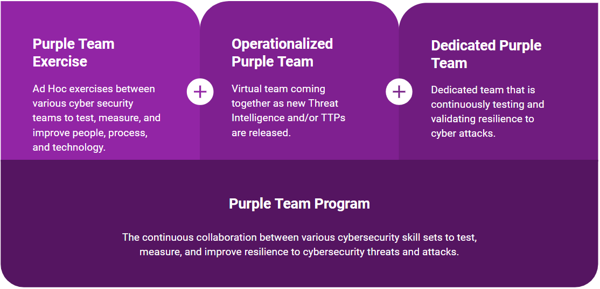
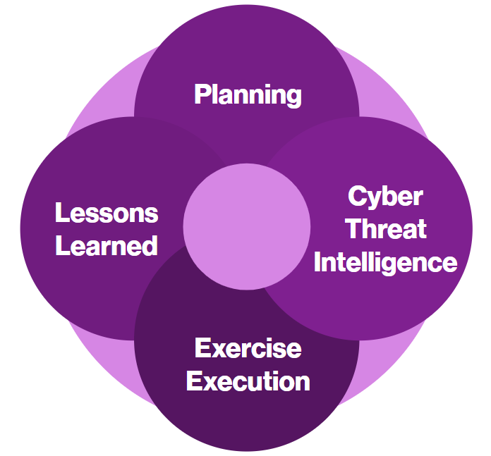
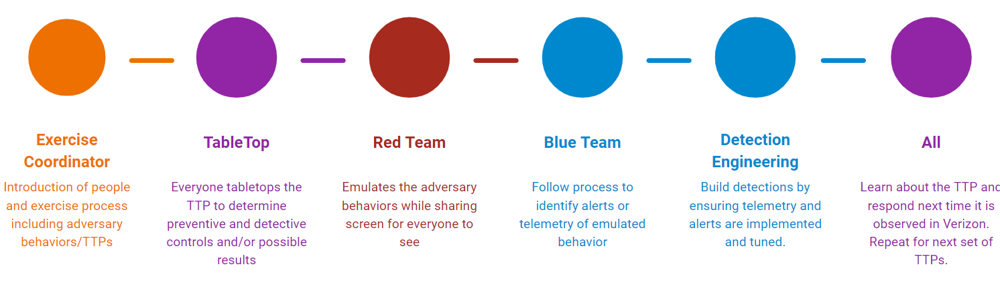
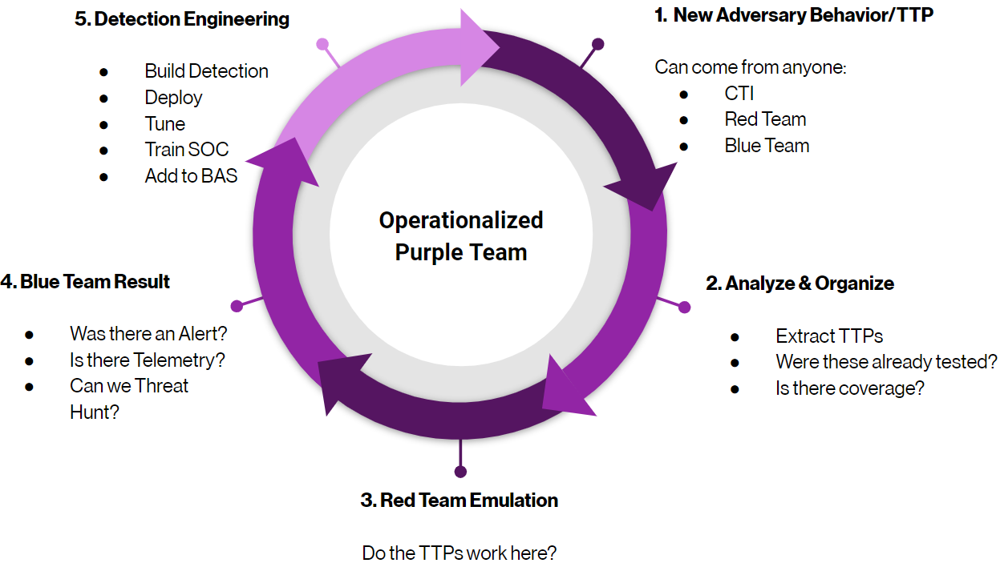
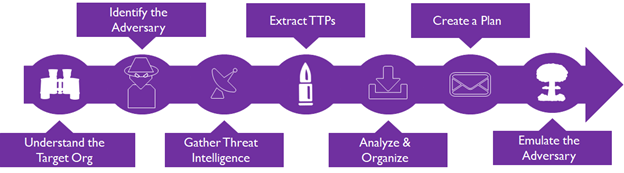
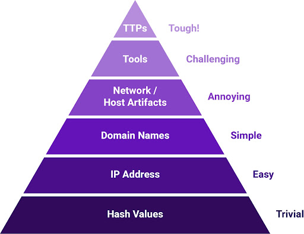
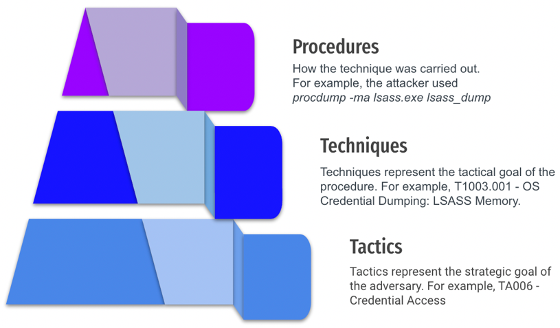
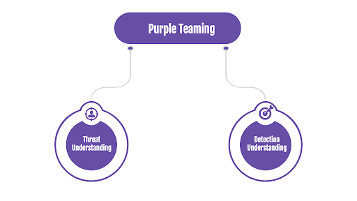
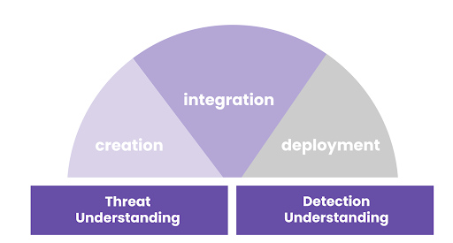
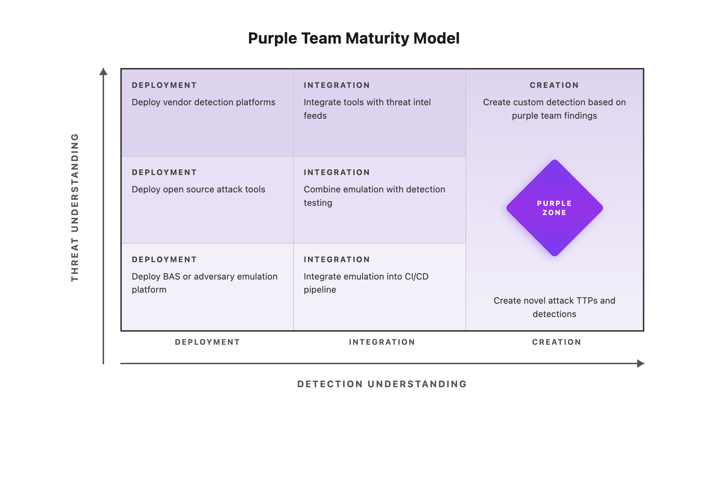

# Purple Team Exercise Framework (PTEF)

This document defines how to build and mature a Purple Team program from ad-hoc Purple Team Exercises, to Operationalized Purple Teaming, to building a Dedicated Purple Team. Purple Team Exercises are an efficient method to test, measure, and improve your organization's resilience to a real cyber attack. Purple Teaming focuses on fostering collaboration with your entire organization including people, process, and technology (security stack).

<p align="center">  </p>

# Table of Contents
1. [Executive Summary](#executive-summary)
    1. [What is a Purple Team?](#what-is-a-purple-team)
    2. [Types of Purple Teams](#types-of-purple-teams)
        1. [Purple Team Exercise](#purple-team-exercise)
        2. [Operationalized Purple Team](#operationalized-purple-team)
        3. [Dedicated Purple Team](#dedicated-purple-team)
2. [Goals and Objectives](#goals-and-objectives)
3. [Methodology](#methodology)
    1. [Industry Frameworks and Methodologies](#industry-frameworks-and-methodologies)
    2. [Regulatory Frameworks and Methodologies](#regulatory-frameworks-and-methodologies)
4. [Roles and Responsibilities](#roles-and-responsibilities)
    1. [Sponsors](#sponsors)
    2. [Exercise Coordinator](#exercise-coordinator)
    3. [Cyber Threat Intelligence Responsibilities](#cyber-threat-intelligence-responsibilities)
    4. [Red Team Responsibilities](#red-team-responsibilities)
    5. [Blue Team Responsibilities](#blue-team-responsibilities)
5. [Planning](#planning)
    1. [Third-Party and MSSP Engagement](#third-party-and-mssp-engagement)
    2. [Planning Meetings](#planning-meetings)
    3. [Technical Preparation](#technical-preparation)
        1. [Cloud and Identity Scoping](#cloud-and-identity-scoping)
    4. [Remote and Hybrid Exercises](#remote-and-hybrid-exercises)
6. [Cyber Threat Intelligence](#cyber-threat-intelligence)
    1. [Understand the Target Organization](#understand-the-target-organization)
    2. [Identify the Adversary to Emulate](#identify-the-adversary-to-emulate)
    3. [Gather Cyber Threat Intelligence](#gather-cyber-threat-intelligence)
    4. [Extract TTPs at the Procedure Level](#extract-ttps-at-the-procedure-level)
    5. [Analyze and Organize](#analyze-and-organize)
    6. [Table Top TTPs](#table-top-ttps)
    7. [Create an Adversary Emulation Plan](#create-an-adversary-emulation-plan)
7. [Purple Team Exercise Execution](#purple-team-exercise-execution)
    1. [Kick Off](#kick-off)
    2. [Exercise Flow](#exercise-flow)
    3. [Tracking Exercise](#tracking-exercise)
8. [Operationalized Purple Team](#operationalized-purple-team-1)
    1. [New Adversary Behavior or TTP](#new-adversary-behavior-or-ttp)
    2. [Analyze and Organize the TTPs](#analyze-and-organize-the-ttps)
    3. [Emulate TTPs](#emulate-ttps)
    4. [Blue Team Results](#blue-team-results)
    5. [Detection Engineering](#detection-engineering)
    6. [Continuous Validation and Automated Testing](#continuous-validation-and-automated-testing)
9. [Dedicated Purple Team](#dedicated-purple-team-1)
10. [AI/ML Systems and Emerging Attack Surfaces](#aiml-systems-and-emerging-attack-surfaces)
11. [Lessons Learned](#lessons-learned)
    1. [Communicating Results to Executives](#communicating-results-to-executives)
    2. [Tracking Action items](#tracking-action-items)
    3. [Retesting](#retesting)
12. [Purple Team Maturity Model](#purple-team-maturity-model)
13. [Templates](#templates)
14. [FAQ](#faq)
15. [Previous Versions](#previous-versions)
16. [Contributors](#contributors)

# Executive Summary

## What is a Purple Team?

A Purple Team is a collaboration of various information security skill sets:

* Cyber Threat Intelligence - research and provide adversary behaviors, tactics, techniques, and procedures (TTPs)
* Red Team - offensive team in charge of emulating adversary behaviors and TTPs
* Blue Team - catch-all phrase for the defenders: Security Operations Center (SOC), Hunt Team, Digital Forensics and Incident Response (DFIR), and/or Managed Security Service Providers (MSSP)

## Types of Purple Teams

As a Purple Team is a collaborative effort between various information security skill sets, it may be applied in a variety of ways. Organizations new to Purple Teaming will start with an ad-hoc [Purple Team Exercise Execution](#purple-team-exercise-execution) to foster the collaboration between the various teams in a single exercise. As the value of Purple Teaming becomes apparent, more exercises are planned and scheduled. Eventually, organizations operationalize the Purple Team function to collaborate as new intelligence or TTPs are discovered. Some organizations build [dedicated Purple Team](#dedicated-purple-team-1) while others keep them separate and use Purple Teaming as a functional, virtual team. Regardless of the model used, the Purple Team can be measured and improved following the [Purple Team Maturity Model](#purple-team-maturity-model).

### Purple Team Exercise

A Purple Team Exercise is a full knowledge information security assessment where attendees collaborate to attack, detect, and respond. Attack activity is exposed, explained, and shown to the attendees as it occurs while defenders also show how they detect and respond. Purple Team Exercises are "hands-on keyboard" exercises where attendees work together with an open discussion about each attack technique and defense expectation to test, measure, and improve people, process, and technology in real-time. Purple Team Exercises are Cyber Threat Intelligence led, emulations of Tactics, Techniques, and Procedures (TTPs) to identify and remediate gaps in the organization's security posture.  

<p align="center">  </p>

At a high level, a live, hands-on keyboard, Purple Team Exercise goes like this:

<p align="center">  </p>

### Operationalized Purple Team 

Purple Teaming can be operationalized with dedicated stakeholders from a variety of information security roles (CTI, Red, and Blue teams) working together as a virtual team. When new TTPs are discovered, they are analyzed, discussed, and emulated to continually build and improve detection and response. This document covers both how to run Purple Team Exercises and how to operationalize purple teaming.

<p align="center">  </p>

### Dedicated Purple Team

We are starting to see enterprises hiring people to dedicated purple team roles. These roles vary from dedicated Purple Team Exercise Coordinators to engagement management of operationalized purple teams to the main stakeholders operating Breach and Attack Simulation solutions. 

# Goals and Objectives

Purple Team Exercises are triggered by the need to test, measure, and improve people, process and technology. Information security professionals from various teams (Blue Team, CTI, and Red Team) will learn and practice their dedicated functions while improving process, and technology. The end goal is increasing resilience to current threats by detecting and responding to attacks before impact. Purple Team Exercises will have specific goals which drive the planning process depending on the maturity level of the organization and current objectives. Purple Team Exercises may have one or more of these goals:

* Foster a collaborative culture within the security organization
* Test attack chains against a target organization
* Train the organization's defenders (Blue Team)
* Test TTPs that have not been tested before in the organization
* Test the processes between security teams
* Preparation for a zero-knowledge Red Team Engagement
* Red Team reveal or replay after a zero-knowledge Red Team Engagement

# Methodology

Leveraging frameworks and methodologies for information security assessments is a best practice to show your sponsors, stakeholders, customers and/or clients you have a repeatable, professional process. No one wants to hire or agree to an engagement without a plan in place that will bring value to the business.  The Purple Team Exercise Framework is in-itself a methodology covering Planning, Cyber Threat Intelligence, Exercise Execution, and Lessons Learned:

<p align="center">  </p>

There are other frameworks for information security assessments such as Threat-Led Penetration Testing and Red Teaming. A mirror of each of the below frameworks is available on the [SCYTHE library](https://www.scythe.io/library/red-team-and-threat-led-penetration-testing-frameworks).

## Industry Frameworks and Methodologies

Industry frameworks are created by those in the industry to be leveraged by other organizations without forcing any sort of regulatory compliance mandates. These frameworks were designed to understand how adversaries operate not how to perform red team engagements, purple team exercises, or adversary emulations/simulations.

* [Cyber Kill Chain](https://www.lockheedmartin.com/en-us/capabilities/cyber/cyber-kill-chain.html) - Lockheed Martin - educated many non-technical consumers on how adversaries function and the steps they perform during a breach.
* [Unified Cyber Kill Chain](https://www.unifiedkillchain.com/) - university paper created by Paul Pols bringing together a number of kill chains by various industry contributors.
* [MITRE ATT&CK](https://attack.mitre.org/) - the current industry standard and language for Adversary Tactics, Techniques, and Common Knowledge

## Regulatory Frameworks and Methodologies

Organizations operating in highly regulated industries, such as financial institutions, and/or in various jurisdictions, have the following frameworks and methodologies to follow:

* G-7 Fundamental Elements for Threat-Led Penetration Testing - the Group of 7 nations provided guidance on performing Threat-Led Penetration Testing
* CBEST Intelligence Led Testing - Bank of England - Regulation for financial institutions operating in England
* Threat Intelligence-Based Ethical Red Teaming - TIBER-EU - framework that can be leveraged by any country in the European Union and offers cross-jurisdiction and mutual recognition of Red Team engagements
* Red Team: Adversarial Attack Simulation Exercises - Association of Banks of Singapore (ABS) 
* Intelligence-led Cyber Attack Simulation Testing (iCAST) - Hong Kong Monetary Authority (HKMA)
* Financial Entities Ethical Red-Teaming - Saudi Arabian Monetary Authority (SAMA)
* Cyber Operational Resilience Intelligence-led Exercises (CORIE) - Australia
* A Framework for the Regulatory Use of Penetration Testing and Red Teaming in the Financial Services Industry - Global Financial Markets Association (GFMA)

# Roles and Responsibilities

Successful Purple Team Exercises require the active planning and participation of a wide range of stakeholders throughout the phases of the Purple Team Exercise: (1) Planning, (2) Cyber Threat Intelligence, (3) Exercise Execution and (4) Lessons Learned. The below table has an example of Roles and Responsibilities for a Purple Team Exercise. 

Please note that not all organizations or exercises require all these stakeholders. Purple Team Exercises can leverage internal and/or external teams. For example, an organization may not have an internal Cyber Threat Intelligence team or they may outsource the SOC to a managed security provider. These organizations can still leverage the efficiencies and benefits of a Purple Team Program.

<table>
  <tr>
   <td><strong>Title</strong>
   </td>
   <td><strong>Role</strong>
   </td>
   <td><strong>Responsibility</strong>
   </td>
  </tr>
  <tr>
   <td>Engagement Manager
   </td>
   <td>Exercise Coordinator
   </td>
   <td>Lead point of contact throughout the entire Purple Team Exercise. Responsible for ensuring Cyber Threat Intelligence is provided. Ensures all Planning steps are taken prior to Exercise Execution. During Exercise Execution, record minutes, notes, action items, and feedback. Compile and deliver Lessons Learned.
   </td>
  </tr>
  <tr>
   <td>Head of Security
   </td>
   <td>Sponsor
   </td>
   <td>Approve Purple Team Exercise and Budget
   </td>
  </tr>
  <tr>
   <td>Cyber Threat Intelligence
   </td>
   <td>Planning, Spectator
   </td>
   <td>Cyber Threat Intelligence
   </td>
  </tr>
  <tr>
   <td>Red Team Manager
   </td>
   <td>Sponsor, Spectator
   </td>
   <td>Planning: Define Goals, Select Attendees
   </td>
  </tr>
  <tr>
   <td>Blue Team Manager
   </td>
   <td>Sponsor, Spectator
   </td>
   <td>Planning: Define Goals, Select Attendees
   </td>
  </tr>
  <tr>
   <td>DFIR Manager
   </td>
   <td>Sponsor, Spectator
   </td>
   <td>Planning: Define Goals, Select Attendees
   </td>
  </tr>
  <tr>
   <td>Red Team
   </td>
   <td>Participant
   </td>
   <td>Planning, Exercise Execution
   </td>
  </tr>
  <tr>
   <td>SOC (Blue Team)
   </td>
   <td>Participant
   </td>
   <td>Planning, Exercise Execution
   </td>
  </tr>
  <tr>
   <td>Hunt Team (Blue Team)
   </td>
   <td>Participant
   </td>
   <td>Planning, Exercise Execution
   </td>
  </tr>
  <tr>
   <td>Digital Forensics & Incident Response (DFIR)
   </td>
   <td>Participant
   </td>
   <td>Planning, Exercise Execution
   </td>
  </tr>
</table>

## Sponsors

Management from participating functions must approve and support the Purple Team Exercise, including the goals, budget, and scope prior to any additional work in the Planning or other phases of the exercise. Managers are responsible for choosing exercise attendees from their teams and removing daily obligations from those individuals during the exercise so they can be focused on the goals and objectives.

## Exercise Coordinator

The Exercise Coordinator(s) is the lead point of contact throughout the entire Purple Team Exercise. They are responsible for ensuring Cyber Threat Intelligence is provided and that all Planning steps are taken prior to Exercise Execution. During Exercise Execution, they should record minutes, notes, action items, and feedback. They are also responsible for compiling and delivering the Lessons Learned document.

## Cyber Threat Intelligence Responsibilities

Cyber Threat Intelligence, whether internal or a third party, is required to provide actionable cyber threat intelligence early in the exercise Planning phase. This team will be responsible for identifying adversaries with the opportunity, intent, and capability to attack the organization as well as consume and extract the adversary tactics, techniques, and procedures (TTPs). Cyber Threat Intelligence analysts should participate as spectators in the Purple Team Exercise to continue learning about the organization.

## Red Team Responsibilities

The Red Team is required to complete a number of responsibilities during the planning phase and be active during the Exercise Execution. Preparation will include understanding the TTPs and ensuring reliable and consistent emulation during the exercise. Red Teams do not have to leverage the same tools and tradecraft as in stealth, red team operations. Operational managers should remove other tasks from Red Team members for successful execution of the Purple Team Exercise.

## Blue Team Responsibilities

The Blue Team is a catch-all term for the defenders. This may include but is not limited to Security Operations Center (SOC), Hunt Team, Digital Forensics and Incident Response (DFIR), and/or Managed Security Service Providers (MSSP). Organizations will vary in the team layout and responsibilities between internal and external providers.

### Security Operations Center Responsibilities

The Security Operations Center (SOC) Manager should plan to attend and have SOC analysts participate in the exercise. Very little time is expected from the SOC in the Planning phase but attendance should be required during the Exercise Execution. SOC management should plan accordingly, removing daily duties from the exercise attendees. Other analysts should be scheduled to cover operations in the participants's absence. Organizations that do not have a Security Operations Center and leverage Managed Security Service Providers (MSSP) can also perform Purple Team Exercises. It will require planning and approval from the MSSP to ensure they can participate in the exercise based on the goals and objectives.

### Hunt Team Responsibilities

If the organization has a Hunt Team, they should participate as well. Very little time is expected from the Hunt Team in the Planning phase but active participation during the Exercise Execution is expected. The Hunt Team Manager should share their most up-to-date playbooks during the Planning Phase to ensure ideal TTPs are chosen for the exercise. Examples of playbooks are available from [ThreatHunter-Playbook](https://github.com/hunters-forge/ThreatHunter-Playbook).

### Digital Forensics & Incident Response Responsibilities

Digital Forensics and Incident Response (DFIR) analysts should participate in the Purple Team Exercise as well. Very little time is expected from DFIR teams in the Planning phase but active participation during the Exercise Execution is expected. DFIR Managers should remove all incident cases from exercise attendees so daily case work can continue and attendance will not affect the DFIR analyst's performance.

### Pre-Exercise Blue Team Preparation

Blue Team leads should complete the following preparation activities before the exercise begins. These tasks build on the general Technical Preparation checklist and address defender-specific readiness that directly affects the quality of exercise results. A Pre-Exercise Blue Team Preparation Checklist is available in the Templates directory.

**Detection Coverage Baseline**

Before any TTPs are tested, the Blue Team should establish a baseline of current detection coverage. Use [DeTT&CT](https://github.com/rabobank-cdc/DeTTECT) to score existing detection coverage against ATT&CK techniques and data sources. Export a current [ATT&CK Navigator](https://mitre-attack.github.io/attack-navigator/enterprise/) layer that maps existing detections, alert rules, and telemetry sources to the ATT&CK matrix. This baseline layer will be compared against a post-exercise layer to measure coverage improvement. At minimum, the baseline should classify each in-scope technique into one of the following categories:

* No visibility (telemetry not collected)
* Telemetry available (logs collected, no detection rule)
* Detection rule deployed (automated alert in place)
* Detection validated (rule confirmed to fire correctly on known-good test data)

**Data Source and Log Ingestion Validation**

Verify that all expected data sources are actively ingesting into the SIEM and other detection platforms. This includes confirming that endpoint telemetry (Sysmon, EDR agents, OS audit logs), network telemetry (DNS, proxy, NetFlow, PCAP), identity and authentication logs (IdP, Active Directory, cloud IAM), and cloud control plane logs (CloudTrail, Azure Activity Logs, GCP Audit Logs) are flowing without gaps. Check for ingestion latency, parsing errors, and dropped events. A detection rule cannot fire if the underlying data never arrives. Use the ATT&CK data sources list for the selected TTPs to confirm that each required data source is present and healthy.

**Review Existing Detection Rules Against Exercise TTPs**

Once the adversary emulation plan and TTP list are shared (or after the table-top discussion), the Blue Team should review whether existing detection rules cover the selected techniques. For each TTP, identify whether a detection rule exists, the platform it runs on (SIEM, EDR, NDR, cloud-native), and the last time it was validated. Flag any TTPs where detection coverage is unknown or untested. This review gives the Blue Team a realistic expectation of what should and should not alert during the exercise, and helps the team prepare targeted hunt queries for TTPs without automated detection.

**Prepare Hunt Queries and Playbooks**

For TTPs where no automated detection exists, the Hunt Team and SOC analysts should prepare ad-hoc hunt queries in advance. These queries should be ready to execute during the exercise so that time is spent investigating rather than writing queries from scratch. Queries should reference the specific data sources, log fields, and behavioral indicators relevant to each TTP. Existing playbooks from resources such as [ThreatHunter-Playbook](https://github.com/hunters-forge/ThreatHunter-Playbook), [Splunk Security Content](https://research.splunk.com/), and [Elastic Detection Rules](https://github.com/elastic/detection-rules) can serve as starting templates.

**Forensic Readiness**

DFIR analysts should verify that forensic tooling is deployed and operational on all target systems before the exercise. This includes memory acquisition tools, disk imaging capabilities, and live forensic utilities. Confirm that the DFIR case created during planning (per the existing Blue Team Preparation checklist) is accessible and that all analysts know the case number and tagging conventions. Validate that evidence collection procedures are documented and that chain-of-custody forms are available.

**Communication and Escalation Dry Run**

Verify that all Blue Team communication channels are operational before the exercise begins. Confirm that SOC analysts, hunt team members, and DFIR analysts can reach each other through the designated exercise communication channels. Review the escalation path so that when a TTP is detected, the team knows who to notify and how to document the finding in real-time. This is especially important for remote and hybrid exercises where communication delays can slow down the exercise flow.

# Planning

Purple Team Exercises can run for a few hours, days, or weeks of hands-on-keyboard collaboration between information security stakeholders. Planning time is based on the goals and objectives that initiated the exercise, guidance or constraints, and the emulated adversary's tactics, techniques and procedures (TTPs).

As an organization builds a Purple Team Program, the planning time will diminish and efficiencies will lead to even more valuable exercises.

### Third-Party and MSSP Engagement

Many organizations leverage external providers for one or more roles in a Purple Team Exercise. Common engagement models include:

* **Full-Service Purple Team** — A single provider supplies CTI, Red Team, and Exercise Coordinator, working with the organization's internal Blue Team. This model is common for organizations new to purple teaming.
* **Red Team as a Service** — An external Red Team executes TTPs based on CTI provided by the organization or a separate CTI provider. The internal Blue Team detects and responds.
* **CTI as a Service** — An external CTI provider delivers the threat intelligence and adversary emulation plan, while internal Red and Blue Teams execute the exercise.
* **Managed Detection Validation** — Organizations using MSSPs or MDR providers include the managed service in the exercise to validate detection and response capabilities across both internal and external security teams.

When engaging third-party providers, additional planning considerations include:

* **Non-Disclosure Agreements** — Ensure NDAs cover all sensitive information shared during planning and execution, including target systems, network architecture, and detection capabilities
* **Rules of Engagement** — Define clear boundaries, escalation procedures, and communication channels. External providers should understand what is in and out of scope before any testing begins.
* **Knowledge Transfer** — Build time into the engagement for the external provider to transfer knowledge to internal teams. The value of a purple team exercise diminishes if findings leave with the consultants.
* **Access and Credentials** — Provision and deprovision access for external participants following the principle of least privilege

## Planning Meetings

For a successful completion of the Planning Phase, planning meetings may be required. The amount of meetings and preparation will depend on the Purple Team Program maturity and if external stakeholders are involved. For example, consultants offering Purple Team Exercises will take more time to prepare than for an internal team that has successfully completed a number of exercises.

### Planning Meeting - Pitch

The first planning meeting can be seen as a pitch of the Purple Team Exercise and Purple Team Program. Sponsors and stakeholders may need to be convinced of the value in collaborating amongst various information security teams. The meeting should introduce the concept of Purple Teaming, present the goals and objectives, and share this methodology that has been used in countless exercises globally across industries. A public use case can be presented to show the instant value provided by a Purple Team Exercise. If previous Purple Team Exercises have been performed with different teams, share the results and improvements from the previous exercises.

### Planning Meeting 1

Once the sponsors and stakeholders agree to a Purple Team Exercise, the following planning meeting should cover all the requirements from the Planning and Cyber Threat Intelligence Phases. A sample agenda is available in the templates folder. Action items should be assigned to the respective stakeholders. The Exercise Coordinator is responsible for tracking and ensuring all the actions are completed before the final planning meeting.

### Planning Meeting 2

The final planning meeting should be held to ensure all the Planning and Cyber Threat Intelligence phase items have been completed and everything is ready for the exercise. The Exercise Coordinator should lead the meeting and go over each action item assigned in the previous planning meetings to validate that all the Planning Phase steps were successfully completed. This may include but is not limited to: 

* Exercise Coordinator(s)
    * Ensuring physical location has met all the requirements including but not limited to power, connectivity to all systems (attack and defend infrastructure), A/C, etc.
    * Determine if table top discussions will occur prior to the exercise or the day of the exercise
    * Agenda has been distributed to all stakeholders
* Red Team Preparation
    * Setup at least 2 systems to show attack activity
    * Ensure Attack Infrastructure is fully functional
    * Ensure Target Systems are accessible 
    * Document all commands required to emulate TTPs in a playbook or adversary emulation plan
    * Test TTPs before exercise on different hosts than the exercise hosts but that are configured similarly
* Blue Team Preparation
    * Validate security tools are reporting to production security tools from the target systems
        * Verify log sources are forwarding properly.
        * Ensure field mapping from logs to SIEM/EDR is correct.
        * Benchmark ingest delays (if any).
    * Ensure attack infrastructure is accessible through proxy/outbound controls
    * Ensure attack infrastructure is being decrypted (TLS decryption/interception)
    * Verify allowlists and notify Red Team
    * Work with Red Team as payloads and C2 are tested prior to exercise on non-exercise systems
    * Create an exercise case as per the DFIR process
        * This will allow tagging artifacts and following normal processes without flagging any suspicious activity (e.g. pulling memory from a system that does not have a formal case)
        * Ensure the target systems are not segmented or wiped as they will be used throughout the exercise.
    *  Ensure the correct forensic tools are deployed on the target systems
    *  Install Live Forensic Tools for efficiency during Purple Team Exercise.

### Logistics

Once attendees have been chosen, logistics planning can begin. Determining the appropriate location for a Purple Team Exercise is critical to the preparation time as travel can be a deciding factor in exercises. The ideal, physical location is generally a Blue Team location where defenders are present. One dedicated conference room with sufficient space for all attendees and their equipment is required for the length of the exercise. Every attendee should arrive with a workstation with media output to quickly show their current screen to other participants (HDMI, DVI, or VGA based on the technology in the room). Exercise coordinators should arrive early on the exercise day to ensure all connectivity is functioning.

### Remote and Hybrid Exercises

If travel is not possible, Purple Team Exercises can be performed remotely or in a hybrid format. Remote and hybrid exercises require additional preparation to ensure effective collaboration.

**Remote Exercise Requirements:**

* **Video Conferencing** — Select a platform that fits your threat model and supports persistent video, screen sharing, and breakout rooms for parallel red/blue team work
* **Collaboration Workspace** — Establish a shared workspace (wiki, shared document, or platform like PlexTrac/VECTR) accessible to all participants in real-time
* **Communication Channels** — Configure dedicated channels (e.g., Slack, Teams) for exercise coordination, separate from production incident channels
* **Screen Sharing Protocol** — Define a clear protocol for when Red Team and Blue Team share screens, ensuring all participants can follow the exercise flow

**Hybrid Exercise Considerations:**

* **Equal Access** — Ensure remote participants have equal access to all exercise materials, shared screens, and communication channels as in-person attendees
* **Bridge Management** — Assign a dedicated person to manage the video bridge, monitor chat for remote participant questions, and relay information between in-person and remote groups
* **Timezone Scheduling** — For distributed teams, schedule exercise blocks during overlapping working hours and clearly communicate all times in UTC

**Exercise Coordinator Tips for Remote/Hybrid:**

* Schedule frequent breaks (10 minutes every 90 minutes minimum) — screen fatigue is more pronounced in remote settings
* Use structured turn-taking during table-top discussions to ensure remote participants can contribute
* Send daily written summaries for multi-day exercises, as remote participants may miss informal hallway conversations
* Record exercise sessions (with participant consent) for asynchronous review by team members in different timezones

### Agenda

Define an agenda for the exercise and share it with the stakeholders beforehand. Ensure to include breaks and provide snacks if physically in the same location. Purple Teaming is hard work and stakeholders will appreciate some coffee, tea, and/or snacks.

### Metrics

Defining the factors that will be measured during the Purple Team Exercise should be defined in the Preparation Phase. Purple Team Exercises focus on Tactics, Techniques, and Procedures (TTPs) or adversary behaviors that do not follow the traditional vulnerability management metrics. A TTP, unlike a vulnerability, is not open or closed. It cannot be easily remediated by applying a patch. These are some of the metrics that may be discussed and agreed upon prior to the exercise:

* Detection Strategies
    * Identify relevant ATT&CK detection strategies for each TTP
    * Map available telemetry to detection analytics
    * Logging events locally and centrally
* Detection Levels
    * Alerts (automated notification)
    * Telemetry (raw data available for query)
    * Indicator of Compromise (IOC match)
    * General Behavior (pattern recognition)
    * Specific Behavior (technique-level identification)
* Response
    * Time to Detect
    * Time to Investigate
    * Time to Remediate

The starting point for metrics is visibility: if you can't see it, there is no basis for action. [DeTT&CT](https://github.com/rabobank-cdc/DeTTECT) provides tooling for scoring detection coverage against ATT&CK techniques and data sources. After logging, we begin to progress to establishing high-fidelity alerts: this is where technology involves human intervention for action; we have now meaningfully started the detection phase. Simple alerts begin with individual techniques/commands on a host and progress to more complex relationships including host and network (invoked command tied to C2 traffic) and lead to detection of the entire attack chain. The catalyst for the progress to this point should be driven by business context, but along the way, more tactical relationships should be correlated with business assets. For example, you might have different versions of sysmon because of this context. Once we have a mature foundation of visibility for detection, the next step is measuring the temporal aspect of our ability to detect, respond, and recover. This phase is more complicated because we're advancing beyond a solely technical view. It's not just technical controls and alerts, but now the inclusion of people and processes: how fast/efficient is our security team's ability to work with current tools and processes.

### Program ROI Metrics

To sustain executive support for a Purple Team Program, teams should track metrics that communicate business value:

* **Detection Coverage Growth** — Track the percentage of ATT&CK techniques with validated detections over time, demonstrating progressive risk reduction
* **Mean Time to Detect (MTTD) Improvement** — Show reduction in detection time across exercises, directly mapping to reduced attacker dwell time
* **Gap Closure Rate** — Percentage of identified gaps remediated within agreed timelines, demonstrating operational follow-through
* **Cost per TTP Tested** — Total exercise cost divided by TTPs tested, showing efficiency gains as the program matures
* **Incident Response Readiness** — Improvement in response metrics (TTI, TTR) that map to reduced impact in real incidents

These metrics help justify continued investment and demonstrate that the Purple Team Program delivers measurable security improvements.

## Technical Preparation

The technical preparation items may take longer on the first exercises as internal processes are established. Exercise Coordinator(s) should track stakeholders that have been assigned action items to ensure they are completed in a timely fashion.

### Target Systems

The Exercise Coordinator(s) should work with stakeholders to identify and provision target systems based on the approved Purple Team Exercise goals and adversary emulation plan. Production/live systems are the most accurate representation of systems in the environment as they should have security tools reporting to production dashboards and allow processes to be accurately tested. In addition, production/live systems are where you have your people, process, and technology.

Based on the approved goals and TTPs, the target systems may be requested following normal processes to ensure consistency with production/live systems. If new systems are requested, they should be built with the same image used for other, similar processes. 

* Endpoint Operating Systems
    * Standard endpoints - recommend 2 of each (Windows 11, Linux, macOS)
    * Physical systems
    * Virtual Desktop Infrastructure
    * Terminal Services/Citrix
* Server Operating Systems in Environment
    * Windows Servers
    * *nix Servers
    * Include Virtual and Cloud Servers
* Cloud Environments
    * AWS, Azure, GCP accounts and subscriptions
    * Container platforms (Kubernetes, ECS, AKS, GKE)
    * Serverless functions and services
    * SaaS tenants (Microsoft 365, Google Workspace, etc.)
* Identity Systems
    * Identity Provider (IdP) environments (Azure AD/Entra ID, Okta, Ping, etc.)
    * Service principals and managed identities
    * Federated trust configurations
    * Privileged Access Management (PAM) systems

### Security Tools

Request the target systems have standard, production tools and configurations deployed in the organization. This may include but not limited to:

* Anti-Virus/Anti-Malware/Anti-Exploit
* Endpoint Detection & Response (EDR) / Extended Detection & Response (XDR)
* SIEM and SOAR platforms
* Network Detection & Response (NDR)
* Forensic Tools (consider live forensic tools that are not standard)
* Cloud Security: Cloud Security Posture Management (CSPM), Cloud Workload Protection Platform (CWPP), cloud-native audit logging (CloudTrail, Azure Monitor, GCP Audit Logs)
* Identity Security: Identity Threat Detection & Response (ITDR), Identity Provider audit logs
* Ensure flow of traffic goes through standard, production network-based devices such as firewalls, proxies, and cloud network security groups

### Target Accounts

Target accounts (a.k.a service accounts, functional IDs) may be created for logging into systems, accessing proxies, and email. While real, production accounts may be used, ensure credentials are not compromised during the Purple Team Exercise based on the TTPs. If this is a concern, the following steps may be taken:

* Request new account of a standard user
* Request Standard Email 
* Request internet and/or proxy access
* Add new account as local administrator of the target systems

### Cloud and Identity Scoping

For organizations with significant cloud and identity infrastructure, additional scoping is required during the technical preparation phase:

* **Cloud Accounts and Subscriptions** — Identify the specific cloud accounts, subscriptions, or projects (AWS, Azure, GCP) that are in scope. Confirm authorization for testing in each cloud environment, as cloud providers have specific penetration testing policies.
* **Identity Provider Scoping** — Determine which identity providers (Azure AD/Entra ID, Okta, Ping, etc.) are in scope for attack emulation. This includes scoping service principals, managed identities, and API credentials.
* **Trust Relationships and Federation** — Map federation trust paths between identity providers and cloud environments. These trust relationships are increasingly targeted by sophisticated threat actors for lateral movement across organizational boundaries.
* **Cloud Security Tool Verification** — Verify that cloud-native security tools (CSPM, CWPP, cloud audit logging) are active and reporting to production dashboards for the in-scope cloud environments.
* **Cloud-Specific Authorization** — Obtain explicit written authorization that covers cloud-specific testing activities, as cloud environments may have different stakeholders and compliance requirements than traditional on-premises systems.

### Attack Infrastructure

Red Team is responsible for establishing the Purple Team Exercise attack infrastructure (internal or external depending on the adversary emulation plan). This involves acquiring the tools that will emulate the adversary behaviors and TTPs. Commonly used adversary emulation platforms include:

* [SCYTHE](https://scythe.io) — Industry-leading Purple Team platform for consistent, reliable adversary emulation with campaign management and reporting
* [MITRE Caldera](https://caldera.mitre.org/) — Open-source adversary emulation platform developed by MITRE with automated agent-based execution
* [Atomic Red Team](https://github.com/redcanaryco/atomic-red-team/) — ATT&CK-mapped library of small, focused test cases for individual technique validation
* For a comprehensive comparison of C2 frameworks, see [The C2 Matrix](https://howto.thec2matrix.com)

Select tooling based on the exercise scope, organizational maturity, and the adversary emulation plan. Larger exercises may leverage multiple platforms, while operationalized testing may standardize on a single platform for consistency.

### External Infrastructure

Leveraging external vs. internal infrastructure will depend on the organization and the goals. A big reason to use external infrastructure is that you can exercise the defensive technology, people, and processes of the perimeter and network in addition to the hosts. But it may require more preparation time.

* Choose and procure external hosting provider
* Create external virtual machines
    * Only allow connection from target organization outbound IP Addresses and Red Teamer IP Addresses
    * Setup credential theft site and/or payload delivery sites
    * Setup C2 Infrastructure - based on payloads and TTP
    * Setup redirectors/relays
* Ensure SMTP servers allow sending emails into organization
    * Shared Email Service should be allowed in
    * If using new SMTP servers, this may require more time for gaining reputation
* Purchase Domains
* Generate or purchase TLS Certificates
* Setup Domain Fronting or other redirectors (if required)
* Categorize domains or ensure proxies/outbound controls allow access
* Provide IPs and Domains to Blue Team if testing will be performed during a planning meeting
* Test payloads and domains with stakeholders to ensure allowlists are complete and payloads/C2 is working. This should be done against test systems; not the same ones for the exercise.

### Internal Infrastructure

* Create internal virtual machines for attack
* Ensure allow listing on Network Access Control solutions
* Setup C2 Infrastructure - based on payloads and TTP
* Test payloads with stakeholders to ensure payloads/C2 is working. This should be done against test systems; not the same ones for the exercise.

# Cyber Threat Intelligence

Cyber Threat Intelligence (CTI) is evidence-based knowledge, context, indicators, and behaviors about a threat to an organization. CTI is one of the many reasons that Purple Team Programs are of high value. While a Red Team can try thousands of methods to reach an objective, a Purple Team will focus on the methods, tradecraft, and TTPs that are most likely to impact the organization. 

The below process for leveraging Cyber Threat Intelligence for Purple Team Exercises was inspired by Katie Nickels and Cody Thomas presentation during the 2018 SANS Threat Hunting & Incident Response Summit titled: "[ATT&CKing the Status Quo: Threat-Based Adversary Emulation with MITRE ATT&CK](https://www.slideshare.net/KatieNickels/threatbased-adversary-emulation-with-mitre-attck)". MITRE has a free training that covers a similar process [Using ATT&CK for Cyber Threat Intelligence Training](https://attack.mitre.org/resources/training/cti/). The below graphics and icons were created by Erik van Buggenhout of [NVISO](https://www.nviso.eu/) and SANS Purple Team SEC599 and SEC699 course author:

<p align="center">  </p>

## Understand the Target Organization

Whether you are a consulting company performing Cyber Threat Intelligence or an internal team, it is very important to understand the target organization. To understand the target organization, the Cyber Threat Intelligence provider should carry out a broad exercise, of the kind typically undertaken by threat actors, as they prepare for their attack from outside the network. The objective is to form a detailed preliminary picture of the entity and its weak points from the attacker's perspective. This will enable the Cyber Threat Intelligence to be put into context and will contribute to the development of the attack chains or attack scenarios to be used in the Purple Team Exercise. Some information should be provided by the organization based on interviews and discussions. The output of this activity is the identification of the attack surfaces of people, processes, and technologies relating to the organizations and its digital footprint. Modern attack surface assessment should also consider cloud infrastructure (IaaS, PaaS, and SaaS environments), identity providers and federation trust relationships, API surfaces exposed to partners or the public, and—where applicable—AI/ML systems deployed in production (see [AI/ML Systems and Emerging Attack Surfaces](#aiml-systems-and-emerging-attack-surfaces)).

While the scope of this document does not include Threat Modeling, it is important to note the importance of understanding the target organization and identifying the adversary to emulate in the following step. If the organization does not have a threat model for effective Cyber Threat Intelligence then they can opt to use a pre-made adversary emulation plan for an adversary that may not be matched to them but is simply well described and has plenty of emulation material available. The exercise will be of less value if the adversary chosen is not chosen because of a relevant threat model.

## Identify the Adversary to Emulate

Consider who's targeting the target organization. For Purple Team Exercises, one will want to consider the adversary's capability, intent, and opportunity. If the organization is new to adversary emulation, start with lower sophistication actors and work into more sophisticated ones as the Purple Team Program matures. The below definitions are taken from the [SANS Digital Forensics Blog](https://digital-forensics.sans.org/blog/2009/07/23/security-intelligence-introduction-pt-2/):


* Intent: Intent stems in a way from impact. It is immutable and driven by the industry you are in just as Impact is. Typically, at a high level, the intent of adversaries to whom security intelligence techniques are applied is data theft. Of course, for each intrusion, each compromise, or each actor, the intent will most likely be slightly different. Is the goal of the adversary to compromise operational details of a campaign, or technical details of a widget? There is nothing that can be done to influence intent.
* Opportunity: Opportunity is about timing and knowledge of the target space. In some cases, it pairs with vulnerability, but not always. It is one thing to be using a product with a 0-day vulnerability in it, but quite another when your adversary knows this. In other respects, however, opportunity is less related. For instance, wouldn't a company's benefits open enrollment period be a great time for a targeted attack on users using socially-engineered, topically-relevant email as a delivery vector?
* Capability: Put simply, capability is the ability of adversaries to successfully achieve their intended goal and leverage opportunity. It is influenced by things such as the skills of the adversaries and the resources (financial, human, and technical) available to them. To extend the 0-day example, a target may be vulnerable, the adversary may intend to steal data by exploiting this 0-day, but if he or she cannot write or obtain the exploit, then the risk is lower.

## Gather Cyber Threat Intelligence

Cyber Threat Intelligence may be obtained through open source intelligence, a vendor, or created internally. It is important to use multiple sources and consider the industry sources such as Information Sharing and Analysis Centers (ISACs). There are many types of Cyber Threat Intelligence as shown in [David Bianco's Pyramid of Pain](https://detect-respond.blogspot.com/2013/03/the-pyramid-of-pain.html):

<p align="center">  </p>


[David Bianco's Pyramid of Pain](https://detect-respond.blogspot.com/2013/03/the-pyramid-of-pain.html)

The type of Cyber Threat Intelligence needed for performing Adversary Emulation and Purple Team Exercises are at the top of the Pyramid of Pain:

* Tactics, Techniques and Procedures (TTPs): How the adversary goes about accomplishing their goals, from initial access all the way through exfiltration and impact. Here is where we can map to [MITRE ATT&CK](https://attack.mitre.org).
* Tools: Software used by the adversary to accomplish their goals. These may be custom malware, open source tools, or tools that come with the systems (often referred to as [Living off the Land](https://lolbas-project.github.io/)). A great list of Command and Control frameworks and tools is available at [The C2 Matrix](https://howto.thec2matrix.com).
* Host Artifacts: Observables caused by adversary activities on one or more hosts.  Examples can be registry keys and values, files or directories, and/or services that are created or modified.

## Extract TTPs at the Procedure Level

Unfortunately, Cyber Threat Intelligence and/or Incident Response reports may not include MITRE ATT&CK mapping or adversary procedure level intelligence. The Cyber Threat Intelligence analysts will need to extract TTPs from the Cyber Threat Intelligence acquired and map it to a framework like ATT&CK, the industry standard to identify and document common TTPs of adversaries. Tactics, Techniques, and Procedures are often abbreviated as TTPs and clustered together as one thing: "The adversary's TTPs". However, they represent three different aspects of adversary activity at different levels of abstraction. Tactics are high-level methods to achieve a goal (e.g. Initial Access, Exfiltration). Techniques and sub-techniques are one step down that refer to how that goal will be achieved (e.g. Spear Phishing a link, Credential Dumping). Procedures are the granular step that describes the steps taken in achieving the goal. 

[Chris Peacock's](https://twitter.com/SecurePeacock) released the [TTP Pyramid](https://www.scythe.io/library/summiting-the-pyramid-of-pain-the-ttp-pyramid) which does a fantastic job breaking up the difference between tactics, techniques, and procedures:

<p align="center">  </p>

Procedures are the ideal Cyber Threat Intelligence needed for Purple Team Exercises. They provide the attendees with the exact steps taken by the adversary. With only technique level mapping to ATT&CK, the Red Team is left to choose generic ways for executing the TTP such as [Atomic Red Team](https://github.com/redcanaryco/atomic-red-team/) test cases. 

## Analyze and Organize

Creating an Adversary Profile is a great way of establishing a high-level plan for how the Red Team will execute the exercise. The goal is to have a simple document to show what the Red Team will emulate. It can be a simple table like this:

<table>
  <tr>
   <td><strong>Tactic</strong>
   </td>
   <td><strong>Technique</strong>
   </td>
   <td><strong>Procedure</strong>
   </td>
   <td><strong>CTI Reference</strong>
   </td>
  </tr>
  <tr>
   <td>Description
   </td>
   <td>Description of adversary
   </td>
   <td>
   </td>
   <td>
   </td>
  </tr>
  <tr>
   <td>Objective
   </td>
   <td>Adversary objectives and goals
   </td>
   <td>
   </td>
   <td>
   </td>
  </tr>
  <tr>
   <td>Command and Control
   </td>
   <td>Technique ID - Technique Name
   </td>
   <td>
   </td>
   <td>
   </td>
  </tr>
  <tr>
   <td>Initial Access
   </td>
   <td>Technique ID - Technique Name
   </td>
   <td>
   </td>
   <td>
   </td>
  </tr>
  <tr>
   <td>Execution
   </td>
   <td>Technique ID - Technique Name
   </td>
   <td>
   </td>
   <td>
   </td>
  </tr>
  <tr>
   <td>Defense Evasion
   </td>
   <td>Technique ID - Technique Name
   </td>
   <td>
   </td>
   <td>
   </td>
  </tr>
  <tr>
   <td>Discovery
   </td>
   <td>Technique ID - Technique Name
   </td>
   <td>
   </td>
   <td>
   </td>
  </tr>
  <tr>
   <td>Privilege Escalation
   </td>
   <td>Technique ID - Technique Name
   </td>
   <td>
   </td>
   <td>
   </td>
  </tr>
  <tr>
   <td>Persistence
   </td>
   <td>Technique ID - Technique Name
   </td>
   <td>
   </td>
   <td>
   </td>
  </tr>
  <tr>
   <td>Credential Access
   </td>
   <td>Technique ID - Technique Name
   </td>
   <td>
   </td>
   <td>
   </td>
  </tr>
  <tr>
   <td>Exfiltration 
   </td>
   <td>Technique ID - Technique Name
   </td>
   <td>
   </td>
   <td>
   </td>
  </tr>
</table>

MITRE has developed the [ATT&CK Navigator](https://mitre-attack.github.io/attack-navigator/enterprise/), a web application that represents ATT&CK techniques in a dynamic fashion. It can be used to select specific techniques based on a threat group or software, after which modifications and annotations can be made. It may have TTPs assigned to an adversary that was not provided in the Cyber Threat Intelligence. Note that the techniques for Groups/Software/Campaigns in Navigator are fully referenced to open sources on MITRE ATT&CK [Groups ](https://attack.mitre.org/groups/) [Software](https://attack.mitre.org/software/) and [Campaign pages](https://attack.mitre.org/campaigns/). Navigator is open-source and can be self-hosted.

## Table Top TTPs

Stakeholders of the Purple Team Exercise should review the TTPs provided by Cyber Threat Intelligence and perform a table-top exercise to pick the TTPs that should be emulated during the Purple Team Exercise. The earlier the TTPs are chosen, the earlier the Planning phase can progress. The TTPs chosen should be actively used by malicious actors targeting the organization and built into attack chains. New TTPs may also be used and are ideal for Operationalized Purple Teaming.

The table top exercise should cover what controls are expected for those TTPs and which teams should have visibility of the TTP activity. TTPs chosen for the exercise should be classified as follows:

* TTPs that are not blocked or prevented - these will provide little value in the exercise but could be emulated if the TTP needs to be highlighted as a concern
* TTPs that may be logged - these are ideal to train hunt teams and have detection engineers create better detection and alerting
* TTPs that may be alerted - these are ideal to train SOC analysts to action and test defensive processes

A matrix should be created showing expected outcomes and team participation:

<table>
  <tr>
   <td><strong>Procedure</strong>
   </td>
   <td><strong>Tactic</strong>
   </td>
   <td><strong>Technique</strong>
   </td>
   <td><strong>ATT&CK Mapping</strong>
   </td>
   <td><strong>Expected Observables</strong>
   </td>
   <td><strong>Expected Visibility</strong>
   </td>
  </tr>
  <tr>
   <td>&lt;Test Case>
   </td>
   <td>&lt;Tactic>
   </td>
   <td>&lt;Technique>
   </td>
   <td>&lt;ATT&CK ID>
   </td>
   <td>&lt;Observable>
   </td>
   <td>SOC, Hunt, and/or DFIR
   </td>
  </tr>
</table>

## Create an Adversary Emulation Plan

The Red Team will be required to know the TTPs in the Planning Phase to create the adversary emulation plan and complete the Planning Phase prior to Exercise Execution. Exercise Coordinators should discuss and decide if to share the TTPs with participants before the Exercise Execution Phase.

Examples of Adversary Emulation Plans are available from the following resources:

* [SCYTHE KnowledgeBase](https://scythe.io/knowledge-base)
* [MITRE Center for Threat Informed Defense Repository](https://github.com/center-for-threat-informed-defense/adversary_emulation_library)
* [Atomic Red Team Tests](https://github.com/redcanaryco/atomic-red-team/) — ATT&CK-mapped test library with procedure-level test cases for individual techniques
* [This Repository!](./emulation-plans/)

We have included a few emulation plans for your use right in the repo under the [emulation-plans](./emulation-plans/) folder. We provided one example of an adversary emulation plan, a controls test, and an emulation plan that matches up to a specific **ATT&CK** and **ATLAS** behavior. 

# Purple Team Exercise Execution

The day of the exercise has arrived. All the planning and preparation will ensure the most efficient use of all the participant’s time. Exercise Coordinator(s), Red Team, and Blue Team leads should arrive early to ensure all systems are working:

* Video conference
* Presentation mode
* Attack Infrastructure accessible
* Target systems accessible

## Kick Off

A sponsor or lead should kick the Purple Team Exercise off by stating the value Purple Team Exercises bring to resiliency while highlighting the progress made due to previous Purple Team Exercises. The kick off should consist of a quick speech that gains interest from attendees about the value of the work to be done in the exercise ahead. 

Introductions should be made if the team has not worked together in the past. The Exercise Coordinator should be able to lead the exercise from that point forward. Once introductions are completed, the Exercise Coordinator should then present the Purple Team Exercise flow.

## Exercise Flow

<p align="center">  </p>

1. Exercise Coordinator or Cyber Threat Intelligence analysts presents the adversary, TTPs, and technical details. This can be a series of slides that introduces the adversary, previous targets, known behaviors, tools, attack vectors leveraged, and the tactics, techniques, and procedures.
2. The Exercise Coordinator should then lead a table-top discussion of each TTP presented. Various stakeholders should provide the expected control or result of the TTP. For example:
    * SOC: Any logs or alerts for this TTP
    * Hunt Team: Any Hunt Cases for this TTP
    * DFIR: Documented methods to identify if TTP was leveraged
3. Red Team executes the TTP while sharing the screen and providing all indicators of compromise and behaviors:
    * Provide attacker IP
    * Provide target
    * Provide exact time
    * Shows the attack to attendees
4. Blue Team will follow standard process to identify evidence of TTP. Time should be monitored to meet expectation and move exercise along. Stakeholders should share screen if TTP was identified due to alerts, threat hunting for logs, or any other evidence. Metrics should be taken and documented.
5. Detection Engineering process can be initiated based on access of stakeholders. Are there any short term adjustments that can increase visibility? If so, implement adjustments and have the Red Team repeat execution of the TTP. Document any output, action items, or notes for the TTP.
6. Repeat for next TTP(s).

## Tracking Exercise

At least one dedicated Exercise Coordinator should be on site to take minutes, notes, action items, and feedback.  For multi-day exercises, daily emails should be sent to all attendees and sponsors with minutes, action items, as well as what is planned for the next day. Tracking of the TTPs can be done through a variety of ways:

* Consider current reporting and tracking tools the organization already uses such as JIRA, Archer, or any other GRC. Customization will most likely need to be performed to track the metrics of Purple Team Exercises.
* [PlexTrac](https://plextrac.com) is an industry leading reporting platform for purple team exercises. It allows tracking of Red Team and Blue Team outcomes along with historical trending. It also allows for more efficient reporting.
* [VECTR](https://vectr.io) is a free solution for tracking Red Team use cases and Blue Team results. 

The Exercise Coordinator may assign more note taking and tracking to members of the different participant teams. 

# Operationalized Purple Team

Purple Teaming can be operationalized with dedicated stakeholders from a variety of information security roles (CTI, Red, and Blue teams) working together as a virtual team. When new TTPs are discovered, they are analyzed, discussed, and emulated to continually build and improve detection and response. The process is illustrated below:

<p align="center">  </p>

## New Adversary Behavior or TTP
Anyone can provide and share details of a new adversary behavior, tactic, technique, or procedure. The CTI team may receive new intelligence from a vendor or from the internal team about a new adversary behavior in the wild, a recent breach, or an external security researcher. The internal Red Team could identify a new TTP in the environment or while conducting research. The internal Blue Team can discover new behavior that has not been seen or tracked before. 

Regardless of who identifies the new behavior, it should be communicated to the virtual Purple Team members. This could be done via a ticket tracking system or collaboration tools such as JIRA, PlexTrac, VECTR, or even a spreadsheet. The new use case should be assigned to relevant stakeholders as part of mini-purple team for this new TTP. Depending on the organization, you may allow self assignment by team members or have a manager assign the TTP for the new mini purple team exercise.

## Analyze and Organize the TTPs 
The next step in an operationalized purple team is to analyze and organize the new adversary behavior, tactic, techniques, and procedures. First, [extract TTPs at the Procedure Level](#extract-ttps-at-the-procedure-level) and map them to MITRE ATT&CK if possible. MITRE ATT&CK allows for a common language between teams and makes the discussions and collaboration easier. Note that MITRE ATT&CK may not have exact mappings for new behaviors as they must be seen in the wild before they are added to the ATT&CK matrix.

Next, correlate the TTPs with what has already been tested in your organization. This requires a decent tracking system. Excel or Google Sheets is the minimum viable product for tracking TTPs as there are solutions made specifically for this including [PlexTrac](https://plextrac.com/), [Tidal](https://www.tidalcyber.com/) , and [VECTR](https://vectr.io).

If this new test case has never been tested, then have a small [tabletop discussion](#table-top-ttps) with the team to understand expectations.

## Emulate TTPs
The Red Team focuses on emulating the new test case and understanding if the adversary behaviors work in the target environment. This involves setting up or reusing attack infrastructure. For operationalized purple teaming, dedicated purple team infrastructure may be stood up for purple team testing. This may include target systems, accounts, and all the standard security tools. If research and testing is performed in a lab environment, the Red Team should then try to emulate the attack in production. The assigned Red Teamer(s) should share and show how to emulate the TTPs with the other assigned purple team members.

## Blue Team Results
Once the TTPs have been validated as possibly working in the target environment, it is time for the Blue Team to share the visibility they have into this attack:
- Was there an alert?
- Was there telemetry?
- Are the required detection sources being collected (per ATT&CK detection strategies)?
- Are detection analytics deployed for these techniques?
- Can the Threat Hunt team hunt for these behaviors?

### Gap Categorization

When a TTP is not detected during a purple team exercise, the root cause matters as much as the detection miss itself. Different gap types require different remediation paths. Each missed detection should be classified into one of the following categories:

**Visibility Gap**

The required telemetry is not being collected. The data source needed to observe the TTP is either not enabled, not forwarded to the SIEM, or not available on the target platform. Remediation requires enabling or onboarding a data source. Example: Sysmon is not deployed on the target endpoint, so process creation events with command-line arguments are not available for detection.

**Detection Logic Gap**

The telemetry is being collected, but no detection rule exists for the TTP. The raw logs are available for manual query, but there is no automated alert. Remediation requires authoring and deploying a new detection rule. Example: PowerShell script block logging is enabled and forwarded to the SIEM, but no rule looks for encoded command execution patterns.

**Alert Suppression Gap**

A detection rule exists and would have fired, but it has been suppressed, tuned out, or disabled due to previous false positive issues. Remediation requires revisiting the tuning decision and creating a more precise rule that separates malicious activity from the legitimate behavior that caused the original false positives. Example: A rule for suspicious scheduled task creation was disabled six months ago because a software deployment tool triggered it repeatedly.

**Process Gap**

The alert fired, but the SOC did not act on it. This may be due to alert fatigue, lack of a response playbook, unclear escalation procedures, or the alert being lost in a queue. Remediation requires changes to process, staffing, or workflow rather than technology. Example: An EDR alert for credential dumping fired and appeared in the console, but the SOC analyst did not investigate it because it was categorized as informational severity.

**Timeliness Gap**

The TTP was eventually detected, but not within the expected timeframe. The detection fired or the hunt found evidence, but the delay would allow an adversary to achieve their objective before the defense responded. Remediation may involve tuning alert severity, adjusting polling intervals, improving near-real-time log forwarding, or adding automated response through SOAR. Example: The TTP was identified through a scheduled hunt query that runs daily, but the adversary behavior would have enabled data exfiltration within hours.

Tracking gap categories across multiple exercises reveals systemic patterns. If the majority of gaps are visibility gaps, the organization has a data engineering problem. If most gaps are process gaps, the organization has a people or workflow problem. This distinction helps leaders allocate remediation resources to the right area.

### Graded Outcome Scoring

A binary pass/fail assessment of detection does not capture the full picture of an organization's defensive posture. The following graded scoring model provides a more nuanced evaluation of each TTP tested during the exercise.

**Scoring Levels**

| Score | Level | Definition |
|-------|-------|------------|
| 0 | No Visibility | No telemetry collected. The TTP produces no observable data in any detection platform. |
| 1 | Telemetry Available | Raw logs or events are collected and available for manual query, but no detection rule or hunt playbook references them. |
| 2 | Hunt Capable | The telemetry is available and a hunt team can find evidence of the TTP through ad-hoc queries or documented hunt playbooks, but no automated alert exists. |
| 3 | Alert Generated | An automated detection rule fires and generates an alert in the SOC queue when the TTP is executed. |
| 4 | Alert Triaged | The alert is generated, picked up by a SOC analyst, correctly identified as a true positive, and escalated per the response playbook within the expected timeframe. |
| 5 | Full Response | The alert is generated, triaged, investigated, and the Blue Team initiates a documented containment or remediation action. The complete detection-to-response chain functions as designed. |

**Using the Scoring Model**

Each TTP tested during the exercise should receive a score from 0 to 5. This score should be recorded alongside the gap categorization to provide a complete picture. For example, a TTP might score a 3 (Alert Generated) with a Process Gap (the alert fired but was not triaged), which tells the team exactly where the breakdown occurred.

Aggregate scores across all TTPs tested in an exercise to produce an overall detection maturity metric. Track this metric across exercises to measure improvement over time. For example, an organization might target moving from an average score of 2.1 to 3.5 within three quarterly exercises.

**Alignment with Detection Robustness**

Graded outcome scoring measures whether the defense works. Detection robustness (as defined by the [Summiting the Pyramid](https://center-for-threat-informed-defense.github.io/summiting-the-pyramid/) project from MITRE's Center for Threat-Informed Defense) measures how resistant the detection is to adversary evasion. These are complementary dimensions. A detection can score a 5 on outcome (full response chain works) but still be fragile if it relies on indicators that an adversary can trivially change (such as a specific filename or hash). Mature organizations should evaluate both outcome scoring and robustness scoring to get a complete picture of detection effectiveness.

### Response Quality Assessment

Detection is only the first half of the defensive mission. Measuring how the Blue Team responds to a detected TTP reveals whether people and processes are keeping pace with technology. The following dimensions should be evaluated for each TTP where an alert or hunt finding was generated.

**Triage Accuracy**

Did the analyst correctly classify the alert as a true positive? Was the severity assessment appropriate? Were any true positives dismissed as false positives, or vice versa? Track the triage accuracy rate across the exercise to identify training needs.

**Playbook Adherence**

If a response playbook exists for the detected technique, did the analyst follow the documented steps? Were any steps skipped or performed out of order? If no playbook exists, document this as a gap and add playbook creation to the post-exercise action items.

**Investigation Depth**

Did the analyst investigate beyond the initial alert to determine scope and impact? For example, if credential dumping was detected on one host, did the analyst check for lateral movement to other hosts using the compromised credentials? The investigation should be proportional to the severity and potential blast radius of the TTP.

**Escalation Timeliness**

Was the finding escalated to the appropriate team (DFIR, Hunt, management) within the expected timeframe? Measure the time from alert acknowledgment to escalation and compare it against the organization's SLA or target. Delays in escalation often indicate unclear escalation criteria or a lack of confidence in the alert's fidelity.

**Containment Decision Quality**

If the Blue Team initiated a containment action (isolating a host, disabling an account, blocking a network connection), was the action appropriate, timely, and proportional? Over-containment (isolating a critical production server when a less disruptive action was available) and under-containment (taking no action when the TTP warranted immediate response) should both be documented.

**Documentation Completeness**

Did the analyst document their findings, investigation steps, and actions in the ticketing system or exercise tracking platform? Complete documentation is essential for post-exercise analysis, knowledge transfer, and regulatory compliance. Gaps in documentation during the exercise often reflect gaps in documentation during real incidents.

Response quality assessment results should be shared constructively with the Blue Team as part of the Lessons Learned process. The goal is to identify systemic process improvements, not to single out individual analysts. Where response quality issues are widespread, the organization should invest in tabletop exercises, playbook development, and analyst training between purple team exercises.

## Detection Engineering

Detection engineering is a critical output of purple team exercises, translating identified gaps into production detection capabilities. The process should follow modern Detection-as-Code practices to ensure detections are maintainable, testable, and auditable.

### Detection-as-Code

Treat detections as software artifacts with full engineering rigor:

* **Version Control** — Store all detection rules in a Git repository alongside documentation and test cases
* **Peer Review** — Require code review for new detections before deployment, ensuring quality and reducing false positives
* **CI/CD Deployment** — Automate detection deployment to SIEM, EDR, and other platforms through a continuous integration pipeline
* **Rollback** — Maintain the ability to quickly revert detections that cause excessive false positives or performance impact

### Detection Formats

Detections identified during purple team exercises should be authored in portable, shareable formats where possible:

* **[Sigma 2.0](https://sigmahq.io/)** — Vendor-agnostic detection rules that can be converted to platform-specific queries (Splunk SPL, Microsoft KQL, Elastic DSL)
* **[YARA](https://yara.readthedocs.io/)** — Pattern matching rules for file and memory scanning
* **Platform-native rules** — Vendor-specific detections for EDR, XDR, or cloud-native security tools when Sigma conversion is insufficient

When designing detections, [MITRE D3FEND](https://d3fend.mitre.org/) can be used as a complementary framework to map defensive techniques to the ATT&CK techniques being tested. D3FEND provides a knowledge graph of countermeasures that helps teams systematically identify which defensive techniques apply to each TTP.

### Detection Lifecycle from Purple Team Findings

When a purple team exercise identifies a detection gap, the following lifecycle applies:

1. **Document** — Record the TTP, the gap, and the telemetry available (from the exercise tracking system)
2. **Design** — Author the detection rule, specifying the logic, data sources, and expected alert fidelity
3. **Validate** — Test the detection against recorded or replayed TTP execution to confirm it fires correctly
4. **Tune** — Adjust thresholds and logic to minimize false positives against baseline environment activity
5. **Deploy** — Push the validated detection to production through the CI/CD pipeline
6. **Regression Test** — Add the TTP to the automated regression testing suite to ensure the detection continues to function

### Threat Hunt to Detection Pipeline

Threat hunting and detection engineering are complementary disciplines that should feed each other in a continuous cycle. Hunts discover new adversary behaviors and validate or invalidate assumptions about visibility. Detection engineering converts validated hunt findings into automated, production-grade alerts. Without a formal pipeline connecting the two, hunt findings remain one-time investigations and detection engineers lack the operational insight needed to write effective rules.

**From Hunt Hypothesis to Detection Rule**

The pipeline follows a structured progression:

1. **Hypothesis Formation** — A hunt is initiated based on a trigger: a purple team finding, a new threat intelligence report, a detection gap identified in a previous exercise, or anomalous behavior observed during routine monitoring. The hypothesis should be specific enough to be testable. For example: "An adversary using Pass-the-Hash will generate Event ID 4624 with Logon Type 9 from a non-standard source process." Frameworks such as [PEAK](https://www.splunk.com/en_us/blog/security/peak-hypothesis-driven-threat-hunting.html) (Prepare, Execute, Act, Knowledge) from Splunk or the SANS [Generating Hypotheses for Successful Threat Hunting](https://www.sans.org/white-papers/37172) methodology provide structured approaches to hypothesis development.
2. **Query Development** — The hunt team writes queries against available telemetry to test the hypothesis. These queries are typically ad-hoc and exploratory, designed to find evidence of the behavior across historical data. Document the data sources used, the query logic, and the fields examined.
3. **Validation and Refinement** — If the hunt discovers evidence of the behavior (or the Red Team demonstrates the TTP to produce observable artifacts), refine the query to distinguish malicious behavior from legitimate activity. This refinement step is where hunt queries start to become detection candidates. Work with the Red Team to execute the TTP multiple times under different conditions to test the query's coverage and false positive characteristics.
4. **Detection Candidate Submission** — When a hunt query reliably identifies a TTP with an acceptable false positive rate, submit it as a detection candidate. The submission should include the ATT&CK technique mapping, the query logic, the data source requirements, the expected false positive rate, sample true positive and false positive events, and the robustness score using [Summiting the Pyramid](https://center-for-threat-informed-defense.github.io/summiting-the-pyramid/).
5. **Detection Engineering Review and Deployment** — Detection engineers receive the candidate and apply the standard Detection Lifecycle: peer review the logic, author it in Sigma or a platform-native format, validate it in a staging environment, tune as needed, and deploy through the CI/CD pipeline.
6. **Knowledge Base Update** — Add the hunt findings and the resulting detection to the organization's knowledge base. Update the ATT&CK Navigator coverage layer. Close the loop with the original trigger (purple team finding, CTI report, or anomaly) to confirm the gap has been addressed.

### Multi-Platform Validation

Detection validation should cover all platforms where the TTP produces observable telemetry:

* **SIEM** — Verify log ingestion, parsing, and detection rule triggering
* **EDR / XDR** — Confirm endpoint-level detection and telemetry collection
* **Cloud-native analytics** — Validate detections in cloud security monitoring (AWS GuardDuty, Azure Sentinel, GCP Chronicle)
* **Network Detection & Response (NDR)** — Verify network-level detection for relevant TTPs

### ATT&CK Navigator Integration

The [MITRE ATT&CK Navigator](https://mitre-attack.github.io/attack-navigator/enterprise/) is a web-based tool for annotating and exploring ATT&CK matrices. Within the purple team workflow, Navigator layers serve as the primary visual artifact for communicating detection coverage, identifying gaps, and measuring progress over time.

**Layer Types for Purple Team Exercises**

Maintain the following Navigator layers throughout the purple team lifecycle:

* **Pre-Exercise Detection Coverage Layer** — Created during the Pre-Exercise Blue Team Preparation phase. This layer maps the organization's current detection posture before the exercise begins. Color-code techniques based on the detection state: no visibility, telemetry only, hunt capable, or alert deployed. This layer establishes the baseline.
* **Threat Actor TTP Layer** — Created during the Cyber Threat Intelligence phase. This layer maps the TTPs of the emulated threat actor to the ATT&CK matrix. Overlaying this layer against the detection coverage layer immediately reveals the gaps the exercise should prioritize.
* **Exercise Results Layer** — Created during exercise execution and updated as TTPs are tested. This layer records the graded outcome score (0 through 5) for each TTP tested. Use a color gradient to represent scores visually (red for 0, yellow for 2-3, green for 4-5).
* **Post-Remediation Coverage Layer** — Created after gap remediation is complete. This layer reflects the updated detection posture and should be compared against the pre-exercise layer to quantify improvement.

**Working with Layers**

Navigator layers are stored as lightweight JSON files. Store these files in the same version-controlled repository as detection rules so that coverage state is tracked alongside detection code. Layers can be exported as SVG or Excel for inclusion in exercise reports and executive briefings.

When multiple layers are loaded simultaneously, the Navigator can overlay them to produce gap analysis views. For example, overlaying the Threat Actor TTP Layer on top of the Pre-Exercise Detection Coverage Layer highlights techniques where the threat actor has known capability but the organization has no detection. These techniques should be prioritized in the exercise scope. A cheatsheet is available (ATT&CK-Navigator-Layer-Cheat-Sheet) in the one-pagers folder.

**Integration with DeTT&CT**

[DeTT&CT](https://github.com/rabobank-cdc/DeTTECT) can generate ATT&CK Navigator layers automatically from data source and detection scoring inputs. Organizations already using DeTT&CT for visibility scoring should export DeTT&CT layers and import them into the Navigator as the baseline detection coverage layer. This eliminates manual mapping and ensures consistency between the visibility scoring model and the exercise preparation artifacts.

**Tracking Progress Across Exercises**

Archive Navigator layers from each exercise to create a historical record of detection maturity. Comparing layers across quarters shows the trend in coverage growth, identifies techniques that regress (detections that were present in a previous exercise but are no longer functioning), and demonstrates program ROI to sponsors. Include before-and-after Navigator layer comparisons in the Lessons Learned report.

### Automated Regression Testing

As part of the detection engineering process, the TTPs will need to be emulated consistently and reliably. Each new detection should be added to an automated regression testing suite (see [Continuous Validation and Automated Testing](#continuous-validation-and-automated-testing)) so that detection drift is identified before it becomes a gap in coverage. The Red Team may automate TTP execution to support both detection engineering iteration and ongoing validation.

The TTPs should be re-ran once the detections have been created to train the rest of the Blue Team and any other Purple Team member/spectator.

## Continuous Validation and Automated Testing

As an organization's Purple Team Program matures, validation should evolve from periodic exercises to continuous, automated testing. Continuous validation ensures that detection capabilities remain effective as environments change, new software is deployed, and security tools are updated.

### Testing Cadence

| Cadence | Scope | Method | Owner |
|---------|-------|--------|-------|
| **Weekly** | Automated regression of existing TTP library | BAS platform or scripted emulation | Purple Team / Detection Engineering |
| **Monthly** | Mini-exercise: 5-10 new or modified TTPs | Hands-on-keyboard with core team | Purple Team Coordinator |
| **Quarterly** | Full Purple Team Exercise with expanded scope | Formal exercise per PTEF methodology | Exercise Coordinator + All Teams |
| **Annually** | Comprehensive exercise with executive reporting | Full-scope exercise including new threat actors | Exercise Coordinator + Sponsors |

### Breach and Attack Simulation (BAS) Integration

Organizations with Breach and Attack Simulation platforms should integrate purple team findings directly into their continuous testing:

* Import validated TTPs from purple team exercises into the BAS platform
* Schedule automated execution against production environments at regular intervals
* Configure alerting for detection regressions (a previously detected TTP is no longer firing)
* Use BAS results to prioritize the next purple team exercise scope

### Automated Regression Testing Workflow

```
[New TTP Identified] → [Detection Created] → [Add to Regression Suite] → [Schedule Automated Execution]
                                                                                    ↓
[Escalate to Purple Team] ← [Alert on Regression] ← [Monitor Detection Results] ←─┘
```

### Continuous Validation Metrics

| Metric | Definition | Target |
|--------|------------|--------|
| **Detection Regression Rate** | % of previously detected TTPs that are no longer detected | <5% per quarter |
| **Mean Time to Detection Regression (MTTDR)** | Time between regression occurring and being identified | <7 days |
| **TTP Coverage Growth** | Net new TTPs added to automated testing per quarter | Positive trend |
| **Automation Ratio** | % of tested TTPs that are validated automatically vs. manually | >70% |

# Dedicated Purple Team
We are starting to see enterprises hiring people to dedicated purple team roles. These roles vary from dedicated Purple Team Exercise Coordinators to engagement management of operationalized purple teams to the main stakeholders operating Breach and Attack Simulation solutions.

# AI/ML Systems and Emerging Attack Surfaces

As organizations deploy AI and machine learning systems in production, these systems introduce attack surfaces that may warrant inclusion in Purple Team exercises. Not every organization requires AI/ML-focused testing—include this scope when the organization operates production AI/ML systems that process sensitive data or make consequential decisions.

## When to Include AI/ML Systems

Consider including AI/ML systems in the exercise scope when:

* The organization deploys customer-facing AI/ML models or LLM-based applications
* AI/ML systems process sensitive data (PII, financial, healthcare)
* Model outputs influence business decisions, access control, or safety-critical functions
* The organization operates training pipelines or model registries with access to production data

## Relevant Frameworks

* [MITRE ATLAS](https://atlas.mitre.org/) (Adversarial Threat Landscape for AI Systems) — ATT&CK-style framework for AI/ML threats, providing tactics and techniques specific to machine learning systems
* [OWASP Top 10 for LLM Applications](https://owasp.org/www-project-top-10-for-large-language-model-applications/) — Identifies the most critical security risks in LLM deployments including prompt injection, data poisoning, and model theft

## AI/ML Attack Surface

| Attack Surface | Examples | Relevant Frameworks |
|----------------|----------|---------------------|
| Model APIs | Inference endpoints, embedding APIs, prediction services | ATLAS, OWASP LLM Top 10 |
| Training Pipelines | Data ingestion, feature engineering, model training infrastructure | ATLAS |
| LLM Integrations | Chat interfaces, RAG systems, AI agents, plugin architectures | OWASP LLM Top 10 |
| Model Registries | Model storage, versioning systems, deployment pipelines | ATLAS |
| AI Infrastructure | GPU clusters, ML platform services, experiment tracking | ATLAS |

## Integration with Exercise Flow

AI/ML testing follows the same five-step methodology used for all TTPs in a Purple Team Exercise:

1. **CTI presents** the AI/ML threat context and relevant adversary techniques from ATLAS
2. **Table-top discussion** of expected controls (input validation, output filtering, model access controls)
3. **Red Team executes** the AI/ML-specific TTP (prompt injection, model evasion, data poisoning attempt)
4. **Blue Team investigates** using AI-specific telemetry and detection capabilities
5. **Detection engineering** creates or improves monitoring for AI/ML attack patterns

## Detection Sources for AI/ML Systems

AI/ML attacks often produce different telemetry than traditional IT attacks. Detection sources include:

* Application-layer logging (API request/response logs, input validation events)
* API gateway telemetry (rate limiting, anomalous query patterns, token usage)
* Model monitoring (prediction drift, adversarial input detection, output anomalies)
* Pipeline audit logs (training data modifications, model registry changes)
* Infrastructure monitoring (GPU utilization anomalies, unusual data transfers)

# Lessons Learned

Exercise Coordinators are responsible for taking minutes, notes, action items, and attendee/sponsor feedback.  The Exercise Coordinators are also responsible for the creation of a Lessons Learned document (Report) following each exercise. 

For the Purple Team Exercise itself, feedback requests should be sent to all attendees on the last day of the Purple Team Exercise to obtain immediate feedback while it is fresh on attendees' minds. 

An example of a Purple Team Exercise report is available in the repositories Templates folder. Other resources include CyberWarDogs post "[How Hot is Your Hunt Team](https://cyberwardog.blogspot.com/2017/07/how-hot-is-your-hunt-team.html)".

Lessons Learned documentation and reports should be completed and sent to Sponsors and Stakeholders in a timely fashion, generally less than 2 weeks after the exercise has concluded.

## Communicating Results to Executives

Purple Team Exercise results must be translated into business-relevant language for executive stakeholders. Technical findings about specific TTPs are important for practitioners, but executives need to understand the impact on organizational risk.

**Executive Report Structure:**

* **Risk Summary** — Frame findings in terms of organizational risk: "Of the 15 techniques used by [threat actor], our security team detected 10 (67%), leaving 5 attack methods that could succeed undetected." Avoid technical jargon.
* **Trend Analysis** — Show progress over time by comparing detection rates, response times, and gap closure across exercises. Executives respond to directional trends more than absolute numbers.
* **Business Impact Mapping** — Connect detection gaps to the business systems and data they put at risk. "The undetected credential access technique could allow an attacker to access [crown jewel system/data]."
* **Investment Recommendations** — Tie remediation action items to specific resource requests (tools, headcount, training) with clear expected outcomes.
* **Maturity Positioning** — Reference the [Purple Team Maturity Model](#purple-team-maturity-model) to show where the organization stands and the roadmap to the next level.

The Exercise Coordinator should present results in person where possible, as the discussion often generates more value than the document itself.

## Tracking Action items

Exercise Coordinator will present the report to the stakeholders that will be responsible for relaying action items to the team(s) responsible for remediation. The stakeholders must accept the findings and action items as well as provide estimated times of completion. 

## Retesting

The emulated activity may need to be performed a number of times, over and over, while the stakeholders, such as detection engineers, work to tune the defensive controls. This is another reason why automated emulation in a consistent and reliable manner is important for Purple Teaming and detection engineering. Adversary emulation platforms such as SCYTHE, MITRE Caldera, or automated testing frameworks allow the consistent, repetitive emulation of adversary behavior by any stakeholder. If automated retesting is not possible, the Exercise Coordinator will have to schedule time between the Red Team and stakeholders to repeat the emulation.

## Post-Exercise Blue Team Responsibilities

The Blue Team's work does not end when the exercise concludes. The following responsibilities ensure that findings translate into measurable security improvements.

### Gap Remediation Ownership

Each detection gap identified during the exercise should be assigned to a specific owner with a defined timeline for resolution. The Blue Team lead is responsible for ensuring these assignments are tracked in the organization's existing workflow system (JIRA, ServiceNow, PlexTrac, VECTR, or equivalent). Gaps should be categorized by severity and mapped to the business systems they put at risk. High-severity gaps (those affecting crown jewel assets or enabling lateral movement to critical systems) should have remediation timelines of no more than 30 days. Medium-severity gaps should target 60 days. Low-severity gaps should target 90 days.

### Detection Deployment Verification

For every new detection rule created as a result of the exercise, the Blue Team must verify that the rule is deployed to production and firing correctly. This verification should occur within two weeks of the exercise. The verification process should include running a controlled re-execution of the TTP (coordinated with the Red Team or using an adversary emulation platform) and confirming that the detection fires, the alert appears in the SOC queue, and the alert contains sufficient context for triage.

### Playbook and Runbook Updates

Update SOC playbooks and DFIR runbooks to reflect new TTPs encountered during the exercise. If the exercise revealed that existing response procedures were incomplete or incorrect, document the specific changes needed and implement them. New playbooks should include the ATT&CK technique ID, expected telemetry, investigation steps, containment actions, and escalation criteria.

### Knowledge Transfer and Training

Blue Team members who participated in the exercise should conduct a knowledge transfer session with the broader team, including analysts who did not attend. This session should walk through the TTPs tested, the detections that worked, the gaps identified, and the new detection rules deployed. The goal is to ensure the entire Blue Team benefits from the exercise, not just the participants.

### Post-Exercise Coverage Layer

Generate an updated ATT&CK Navigator layer that reflects the detection coverage after remediation is complete. Compare this layer against the pre-exercise baseline to quantify improvement. This comparison should be included in the Lessons Learned report to sponsors and can be used in the executive reporting process described in Communicating Results to Executives.

# Purple Team Maturity Model

Regardless of implementation, a purple team program can be measured and matured following the Purple Team Maturity Model (PTMM). The maturity model looks at purple team activities as a unified effort with two key areas of expertise: Threat Understanding and Detection Understanding. Within each area of expertise there are three levels for teams to measure their maturity: Deployment, Integration, and Creation. Utilizing this model, purple team programs can chart a strategic map around how to build internal capability for purple team activities. 

Thus far, purple team is mostly used as a verb - referencing the execution of an exercise that brings together a combination of blue team, red team, and cyber threat intelligence. The exercises include planning, an agreed upon scope and series of tests, and a lot of communication and transparency throughout the process. The focus on communication and the blended expertise is why these exercises tend to have such a high return on investment. The increasing popularity and expectations of security teams around the globe to conduct purple team exercises supports this.

The Purple Team Maturity Model encourages the shift to using purple team as a noun - creating permanent teams who share common goals and leverage their varied expertise outside of periodic exercises. These new blended teams will be measured through two categories: threat understanding and detection understanding. 

Within each category, we propose three levels of maturity:

<p align="center">  </p>

## Level 1: Deployment

This is where most teams start their journey: deploying tools developed by someone else. Those tools might include vendor platforms like [SCYTHE](https://scythe.io), open source projects like [MITRE Caldera](https://caldera.mitre.org/) and [Atomic Red Team](https://atomicredteam.io/), or known C2 frameworks listed in [The C2 Matrix](https://howto.thec2matrix.com). 

## Level 2: Integration

Integration - pairing tools and resources together to achieve greater effect - is the next step in capability development and maturity. The question here is "can we integrate this new tool into our existing technology/process stack (or can we combine two existing tools)"?

## Level 3: Creation

Our final level of maturity is creation - adding novel tools to the capabilities developed in previous levels. Creation is our final level because understanding a tool, process, or technique to the point where it can be applied to a new use case demonstrates significant capability to adapt to changing threats.

<p align="center">  </p>

## The Full Model

These three levels are meant to be viewed as a team to gauge overall capability, but can also be leveraged to gauge capability with a specific tool or technology. Combining the levels of understanding with the two categories of understanding creates the PMM.

<p align="center">  </p>

We used color coding to emphasize the required balance between threat and detection understanding to achieve purple, but there's no wrong way to get to the top right corner of the box (what we would consider an advanced purple team). Maybe your organization has a highly skilled team who understands how to create new detections based on the latest cyber threat intelligence; they probably think of themselves as a blue team and sit in the top left corner of our box. This team needs to improve their threat understanding to build their capabilities into purple territory - enabling testing of their detections and guiding development of new ones. The first step for this team might be deploying a tool like the [SCYTHE platform](https://scythe.io) or Red Canary's [Atomic Red Team Project](https://github.com/redcanaryco/atomic-red-team) with one of the public emulation plans available from MITRE Engenuity's [Center for Threat Informed Defense](https://github.com/center-for-threat-informed-defense/adversary_emulation_library)plans. As they advance in their threat understanding journey, they might hire someone to refine their threat model or write new adversary techniques to keep their detections on the cutting edge. While there are many paths to purple, if you are looking for guidance on how to invest your limited resources, we would recommend prioritizing balance. Ask yourself where your team falls in the square and what you need to move closer to the purple diagonal. The ultimate goal is to create a team with advanced understanding of both threats and detections, allowing them to better defend the organization.

# Templates

Templates for Purple Teaming can be found in the [templates](./templates/) folder. We encourage you to contribute by submitting pull requests.

## Quick-Reference One-Pagers

Printable single-page guides are available in the [one-pagers](./one-pagers/) folder for use during exercises:

| Guide | Phase | Purpose |
|-------|-------|---------|
| [Exercise Checklist](./one-pagers/01-Exercise-Checklist.md) | All | Pre/during/post exercise checkboxes |
| [Roles Reference](./one-pagers/02-Roles-Reference.md) | Pre-Exercise | Quick lookup for each role's responsibilities |
| [CTI Process](./one-pagers/03-CTI-Process.md) | Pre-Exercise | 7-step CTI flow with key questions at each stage |
| [Pre-Exercise Blue Team Checklist](./one-pagers/07-Pre-Exercise-Blue-Team-Checklist.md) | Pre-Exercise | Blue Team preparation before exercise day |
| [Exercise Day](./one-pagers/04-Exercise-Day.md) | Exercise Day | Flow diagram + Red/Blue coordination checklist |
| [Metrics Guide](./one-pagers/05-Metrics-Guide.md) | Exercise Day | What to measure, how to measure, tracking templates |
| [ATT&CK Navigator Layer Cheat Sheet](./one-pagers/10-ATT&CK-Navigator-Layer-Cheat-Sheet.md) | Exercise Day | Creating, combining, and managing Navigator layers |
| [Detection Lifecycle Checklist](./one-pagers/08-Detection-Lifecycle-Checklist.md) | Post-Exercise | Gap-to-production detection workflow |
| [Hunt-to-Detection Pipeline Checklist](./one-pagers/09-Hunt-to-Detection-Pipeline-Checklist.md) | Post-Exercise | Convert hunt findings into detection rules |
| [PTMM Poster](./one-pagers/06-PTMM-Poster.md) | Ongoing | Visual maturity model with self-assessment |

PDF versions are also available in the same folder for printing. 

# FAQ

There is a common complaint from dedicated Red Teams who find themselves additionally assigned to purple team exercises: if they have a high operational tempo and low preparation time between exercises (which many do), then they are forced to arrive at purple team events with their everyday red team tools. But using their everyday red team tools (which are customized or custom to avoid detection) for purple team exercises can result in their custom tools being burned (effectively detected and therefore unusable for covert operations) and their costly investment in tool development being devalued.

Now, there are a number of common responses to this complaint.

1. "Deal with it, red team. That's your job."

But is it? A red team is supposed to be quiet and unobserved so that they can focus on achieving exercise objectives. If their tools and TTPs are arbitrarily burned during purple team exercises, then they spend a significant amount of time on the top of the Pyramid of Pain[^1] and little on actually doing operations (which is what they're well paid to spend time doing). Many red teams (regardless of theory) are not emulating particular adversaries, they are their own threat actor with custom tools, TTPs, and standard operating procedures. This is so they can consistently remain undetected throughout operations and focus on achieving objectives. Taking this privilege away means that much of their effort is spent in churn rather than operational success, redeveloping tools over and over again as each one is made, used, and burned before it may be used again.

2. "Give the red team time to build custom tools or acquire alternative tooling for the exercise."

This may work in theory, but how many red teams are paid solely for tool development? Not many.

3. "Require the blue team to not signature tools; focusing on building detections for TTPs."

This theoretically eliminates the problem entirely since custom tools won't be signatured and the TTPs in the purple team exercise are emulations of a chosen threat rather than the red team's, but... will the Blue Team follow that rule? The answer depends on the team and culture.

4. "An approach we have seen success with is to ensure that the "red team" group that participates in purple team exercises is fully dedicated to that role and siloed away from the full-time red teamers who perform zero-knowledge exercises. That way, the people doing zero-knowledge exercises can focus on their role without distraction or compromising their investment in covert tooling. Meanwhile, the people who focus on purple team exercises can be the ones who spend time and money building emulation tools with the intention of collaboratively burning them with the blue team."

This approach may be ideal, but it should be recognized that many organizations do not have the resources to support both a dedicated red team and purple team. As such, if resources are constrained, consider pairing an individual red teamer with the blue team for a long enough period of time that they may prepare a purple team exercise that does not require their custom red team tools. This allows the rest of the red team to remain focused on their objectives while still supporting the organization by contributing to purple team exercises.

# Previous Versions

## PTEFv3
PTEFv3 expanded on PTEFv2 by defining Operationalized Purple Teaming and Dedicated Purple Teams. Released at RSA Conference 2023.
* [Markdown](./PTEFv3.md)
* [PDF](./PTEFv3.pdf)

## PTEFv2
PTEFv2 expanded on the first version to consider third party providers that focus on CTI, Red Team, and/or Blue Team. This was due to the amount of enterprises requesting consulting providers to help run a Purple Team Exercise and managed service providers (e.g. Managed Detection and Response).
* [Markdown](./PTEFv2.md)
* [PDF](./PTEFv2.pdf)
* [Slides](./PTEFv2-RoundUp.pdf)

## PTEFv1
PTEFv1 was the first release of the Purple Team Exercise Framework and focused solely on running a Purple Team Exercise inside an enterprise that has formal teams covering CTI, Red Team, and Blue Team:
* [Markdown](./PTEFv1.md)
* [PDF](./PTEFv1.pdf)

# Contributors
We would like to express our gratitude for all the contributors to the Purple Team Exercise Framework. What started as a process followed in a single organization has been shared and used by countless enterprises, consulting companies, and managed service providers. Without the feedback and support, this framework would not be the industry standard for Purple Team Exercises. Thank You!

## PTEFv1
Thank you to all those that reviewed and provided feedback for the first version of the Purple Team Exercise Framework: 
* Ben Goerz
* Bryson Bort
* Dave Mayer
* Erik van Buggenhout
* Jorge Orchilles
* Katie Nickels
* Mauricio Velazco
* Xena Olsen

## PTEFv2
We appreciate the feedback, pull requests, and community contributions of everyone that has spent the time to provide us lessons learned from their own exercises. The below team authored version 2 of the Purple Team Exercise Framework:
* Christopher Peacock
* Jorge Orchilles
* Tim Schulz
* Shawn Edwards

## PTEFv3
PTEFv3 was released during RSA Conference 2023 and authored by Jorge Orchilles.

## PTEFv4
PTEFv4, released in January 2026, is a comprehensive overhaul focused on practitioner usability, documentation, and improved references:
* Quick-reference one-pagers for exercise execution
* Improved documentation structure and navigation
* Contributor guidelines and enhancement roadmap
* PDF versions for all documentation

Contributors:
* Trey Bilbrey
* Tyler Casey
* Jarrad Pemberton