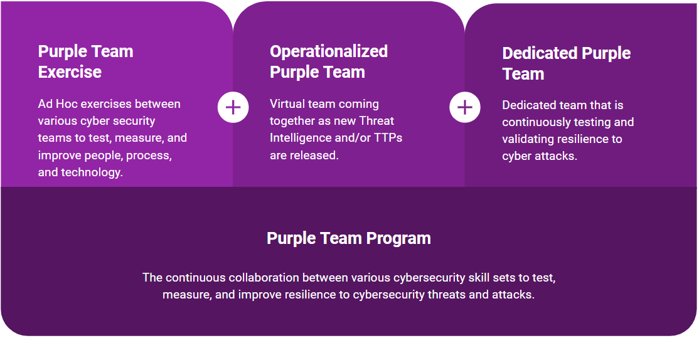

# Purple Team Exercise Framework (PTEF)

  

The **Purple Team Exercise Framework (PTEF)** is the industry standard methodology for designing and executing collaborative security exercises that bring together Cyber Threat Intelligence (CTI), Red Teams, and Blue Teams.

Purple Team Exercises are an efficient method to test, measure, and improve your organization's resilience to real cyber attacks. The framework covers:

- **Purple Team Exercises** - Ad-hoc collaborative exercises
- **Operationalized Purple Team** - Continuous virtual team effort
- **Dedicated Purple Team** - Dedicated staff roles

## What's New in v4

PTEFv4 is a comprehensive overhaul focused on **practitioner usability**:

- **Quick-Reference One-Pagers** - Printable single-page guides for use during exercises
- **Improved Documentation** - Streamlined navigation, fixed errors, better organization
- **Cloud & Identity Coverage** - Cloud environments, identity providers, and modern infrastructure scoping
- **AI/ML Threat Guidance** - MITRE ATLAS, OWASP LLM Top 10, and AI/ML attack surface coverage
- **Detection Engineering Expansion** - Detection-as-Code, Sigma rules, CI/CD deployment, detection lifecycle
- **ATT&CK v18 Alignment** - Updated to Detection Strategies + Analytics terminology
- **Broadened Tool Ecosystem** - SCYTHE, MITRE Caldera, Atomic Red Team, and The C2 Matrix references
- **Continuous Purple Teaming** - Automated regression testing, BAS integration, validation metrics
- **Remote/Hybrid Exercise Guidance** - Detailed guidance for remote and hybrid exercise logistics
- **Contributor Guidelines** - Clear process for community contributions
- **PDF Generation** - All documentation available in PDF format

## Documentation

**[Read the Full Framework (PTEFv4)](./PTEFv4.md)** - The complete methodology including:

- Executive Summary & Definitions
- Goals and Objectives
- Industry & Regulatory Frameworks
- Roles and Responsibilities
- Planning Phases
- Cyber Threat Intelligence Process
- Exercise Execution Flow
- Lessons Learned
- Purple Team Maturity Model (PTMM)
- FAQ

**Download:** [PTEFv4.pdf](./PTEFv4.pdf)

## Quick-Reference Guides

Printable one-page guides for use during exercises are available in the [one-pagers](./one-pagers/) folder:

| Guide | Purpose | PDF |
|-------|---------|-----|
| [Exercise Checklist](./one-pagers/01-Exercise-Checklist.md) | Pre/during/post exercise checkboxes | [PDF](./one-pagers/01-Exercise-Checklist.pdf) |
| [Roles Reference](./one-pagers/02-Roles-Reference.md) | Quick lookup for each role's responsibilities | [PDF](./one-pagers/02-Roles-Reference.pdf) |
| [CTI Process](./one-pagers/03-CTI-Process.md) | 7-step CTI flow with key questions | [PDF](./one-pagers/03-CTI-Process.pdf) |
| [Exercise Day](./one-pagers/04-Exercise-Day.md) | Flow diagram + Red/Blue coordination | [PDF](./one-pagers/04-Exercise-Day.pdf) |
| [Metrics Guide](./one-pagers/05-Metrics-Guide.md) | What to measure and tracking templates | [PDF](./one-pagers/05-Metrics-Guide.pdf) |
| [PTMM Poster](./one-pagers/06-PTMM-Poster.md) | Visual maturity model with levels | [PDF](./one-pagers/06-PTMM-Poster.pdf) |

## Templates

Templates for running Purple Team Exercises are available in the [templates](./templates/) folder:

- [Purple Team Exercise Template](./templates/Purple%20Team%20Exercise%20Template.docx) (.docx)
- [TTP Mapping Template](./templates/Template_Mapping_TTPs.xlsx) (.xlsx)
- [Emulation Plan Template](./templates/Emulation%20Plan%20Template.md) (.md)

## Version History

| Version | Description | Links |
|---------|-------------|-------|
| **v4** (Current) | Practitioner usability overhaul: one-pagers, improved docs, contributor guidelines | [Markdown](./PTEFv4.md) \| [PDF](./PTEFv4.pdf) |
| v3 | Adds Operationalized Purple Teaming and Dedicated Purple Teams | [Markdown](./PTEFv3.md) \| [PDF](./PTEFv3.pdf) |
| v2 | Expanded for third-party providers (consultants, MSSPs) | [Markdown](./PTEFv2.md) \| [PDF](./PTEFv2.pdf) \| [Slides](./PTEFv2-RoundUp.pdf) |
| v1 | Original version for internal enterprise teams | [Markdown](./PTEFv1.md) \| [PDF](./PTEFv1.pdf) |

## Contributing

We welcome contributions! Please see [CONTRIBUTING.md](./CONTRIBUTING.md) for guidelines on how to submit pull requests, report issues, and suggest improvements.

## License

This project is licensed under the MIT License - see the [LICENSE](./LICENSE) file for details.

## Acknowledgments

PTEF was created by [SCYTHE](https://scythe.io) and has been used by countless enterprises, consulting companies, and managed service providers worldwide. Thank you to all [contributors](./PTEFv4.md#contributors) who have helped make this the industry standard for Purple Team Exercises.

---

**Repository**: [github.com/scythe-io/purple-team-exercise-framework](https://github.com/scythe-io/purple-team-exercise-framework)
