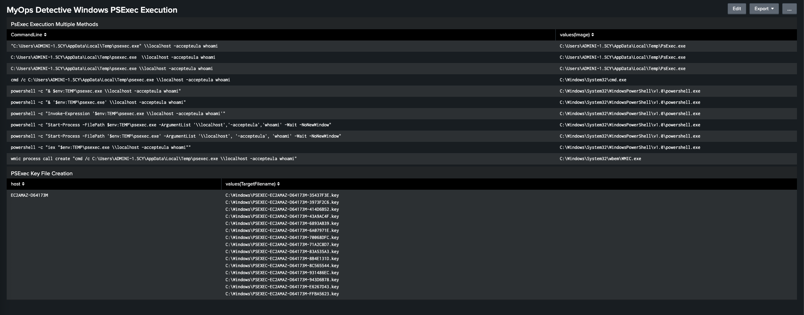

# PsExec Execution

| | |
|---|---|
| **ATT&CK Technique** | [T1569.002 - System Services: Service Execution](https://attack.mitre.org/techniques/T1569/002/), [T1021.002 - SMB/Windows Admin Shares](https://attack.mitre.org/techniques/T1021/002/) |
| **Platform** | Windows |
| **Permissions Required** | Standard user or Administrator |
| **Dependencies** | None (PsExec downloaded during test) |

## This test focuses on detecting remote process execution using PSExec utility through multiple means

This detective test validates detection capabilities around **PSExec** execution patterns commonly used for lateral movement and process execution. Organizations need to monitor process creation events and network authentication attempts that indicate remote execution tools. The technique demonstrates how PSExec can be invoked through multiple execution methods, testing detection coverage across different parent processes and invocation patterns.

The test demonstrates PSExec execution behavior through various wrapper methods. The test downloads PSExec from the official Microsoft Sysinternals location and executes it via direct calls, **cmd** shell wrappers, **PowerShell** operators, **process creation** methods, and **WMI** calls to validate comprehensive detection coverage.

---

### Prerequisites

- **Operating System:** Windows 10/11 or Windows Server 2016+
- **Shell:** Run all commands from an **PowerShell** prompt unless otherwise noted
- **Network Access:** Outbound HTTPS to `live.sysinternals.com` for PsExec download
- **Permissions:** Standard user **or** Local Administrator on the target host

---

### Manual Emulation

**Download PSExec** *(PowerShell)*

```powershell
Invoke-WebRequest -Uri "https://live.sysinternals.com/PsExec.exe" -OutFile "$env:TEMP\PsExec.exe"
# Expected: PsExec.exe saved to $env:TEMP
```

**Direct Execution** *(CMD prompt)*

```cmd
%TEMP%\psexec.exe \\localhost -accepteula whoami
REM Expected: returns current username (e.g., "nt authority\system" or "DOMAIN\user")
```

**CMD Wrapper** *(PowerShell or CMD)*

```cmd
cmd /c "%TEMP%\psexec.exe \\localhost -accepteula whoami"
```

**PowerShell Call Operator** *(PowerShell)*

```powershell
& "$env:TEMP\psexec.exe" \\localhost -accepteula whoami
```

**PowerShell Start-Process** *(PowerShell)*

```powershell
Start-Process -FilePath "$env:TEMP\psexec.exe" -ArgumentList '\\localhost','-accepteula','whoami' -Wait -NoNewWindow
```

**WMIC Process Creation** *(CMD prompt)*

```cmd
wmic process call create "cmd /c %TEMP%\psexec.exe \\localhost -accepteula whoami"
```

**Clean-up** *(PowerShell)*

```powershell
Remove-Item "$env:TEMP\PsExec.exe" -Force
```

*Or from CMD:*

```cmd
del "%TEMP%\PsExec.exe"
```

---

---

### Detections

**Psexec Execution Multiple Methods**

- Detects user accept agreement execution in PsExec CommandLine and execution through non-standard command lines.

**PSEXEC Remote Execution File Artifact**

- Detects creation of the PsExec key file. Which is created anytime a PsExec command is executed. It gets written to the file system and will be recorded in the USN Journal on the target system.



> **Caption:**Detections via Splunk

---

Leveraging these detection opportunities empowers you to proactively tackle **PsExec**, enhancing your overall cybersecurity defenses and ensuring robust protection against potential threats; significantly reducing your **Mean Time to Detect (MTTD)** and **Mean Time to Respond (MTTR).**

---

