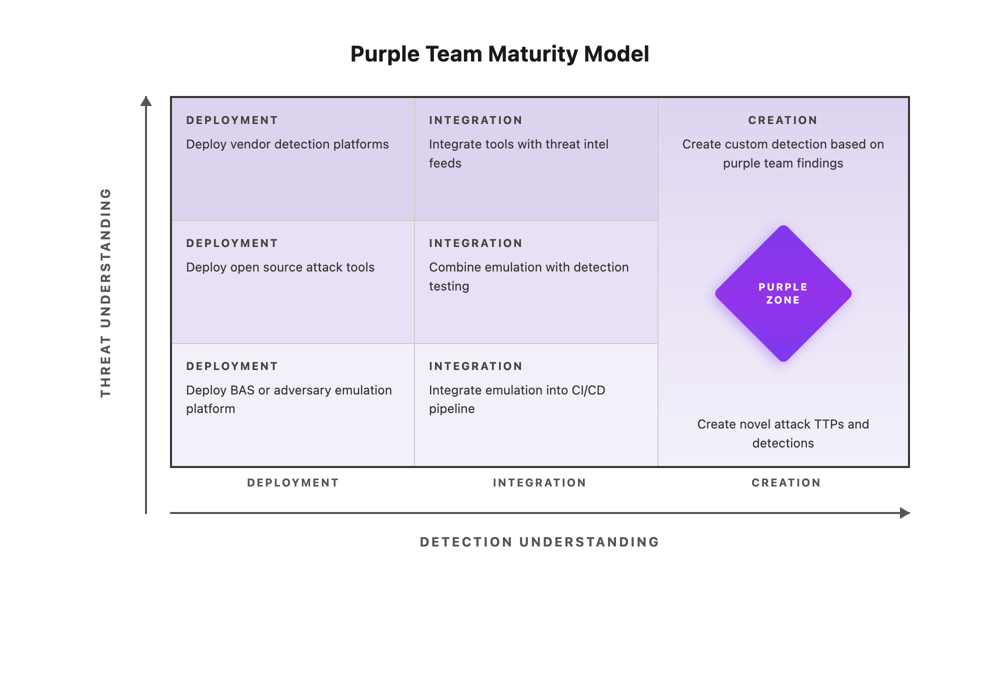
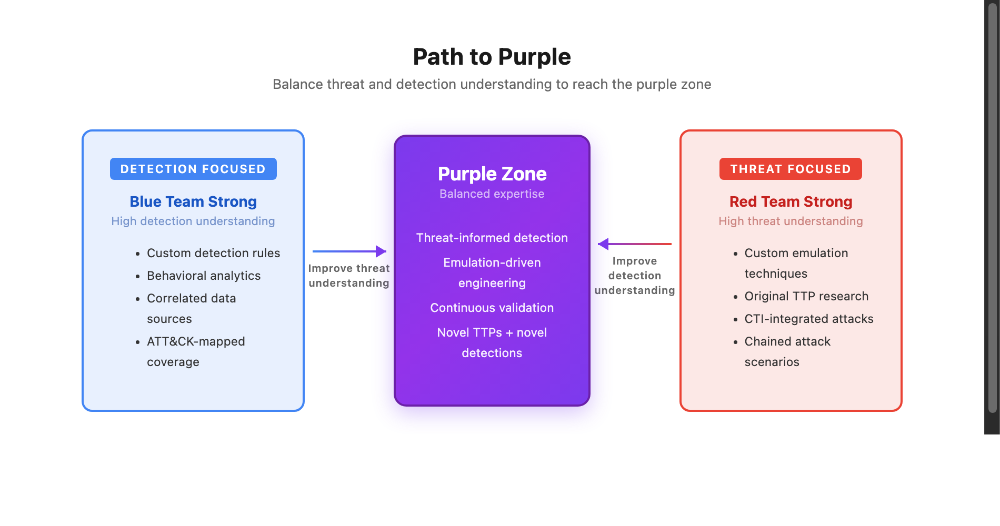

# Purple Team Maturity Model (PTMM)

## The Model

  

---

## Level Definitions

### DEPLOYMENT (Level 1)
**Using tools developed by others**

| Threat Understanding | Detection Understanding |
|---------------------|------------------------|
| Deploy BAS platform (SCYTHE, etc.) | Deploy vendor EDR/SIEM |
| Use Atomic Red Team tests | Use vendor detection rules |
| Run existing emulation plans | Deploy threat intel platform |

**Key Question:** Are we using available tools?

---

### INTEGRATION (Level 2)
**Combining tools for greater effect**

| Threat Understanding | Detection Understanding |
|---------------------|------------------------|
| Integrate CTI feeds with emulation | Integrate threat intel with SIEM |
| Combine multiple attack tools | Correlate across data sources |
| Chain TTPs into realistic attacks | Map detections to ATT&CK |

**Key Question:** Are our tools working together?

---

### CREATION (Level 3)
**Developing novel capabilities**

| Threat Understanding | Detection Understanding |
|---------------------|------------------------|
| Write custom emulation techniques | Create custom detection rules |
| Develop new attack procedures | Build behavioral analytics |
| Research emerging threats | Develop novel detection methods |

**Key Question:** Are we innovating beyond available tools?

---

## Path to Purple

  

---

## Self-Assessment Questions

### Threat Understanding
| Level | Question | Y/N |
|-------|----------|-----|
| Deployment | Do we use adversary emulation tools? | |
| Deployment | Do we run existing emulation plans? | |
| Integration | Do we integrate CTI with emulation? | |
| Integration | Do we chain TTPs into attack scenarios? | |
| Creation | Do we develop custom attack procedures? | |
| Creation | Do we research and implement new TTPs? | |

### Detection Understanding
| Level | Question | Y/N |
|-------|----------|-----|
| Deployment | Do we have EDR/SIEM deployed? | |
| Deployment | Do we use vendor detection rules? | |
| Integration | Do we correlate across data sources? | |
| Integration | Do we map coverage to ATT&CK? | |
| Creation | Do we write custom detection rules? | |
| Creation | Do we develop behavioral analytics? | |

---

## Maturity Indicators

Read each row left to right — Deployment is the starting point, Creation is the most mature.

| Indicator | Deployment | | Integration | | Creation |
|-----------|:----------:|:---:|:-----------:|:---:|:--------:|
| **Tool usage** | Vendor tools | → | Combined tools | → | Custom tools |
| **CTI consumption** | Read reports | → | Automated feeds | → | Original research |
| **Detection rules** | Vendor-provided | → | Tuned/customized | → | Novel detection |
| **Emulation plans** | Public plans | → | Adapted plans | → | Custom plans |
| **Team structure** | Separate teams | → | Virtual purple team | → | Dedicated purple team |

---

*Purple Team Exercise Framework v4 — github.com/scythe-io/purple-team-exercise-framework*
